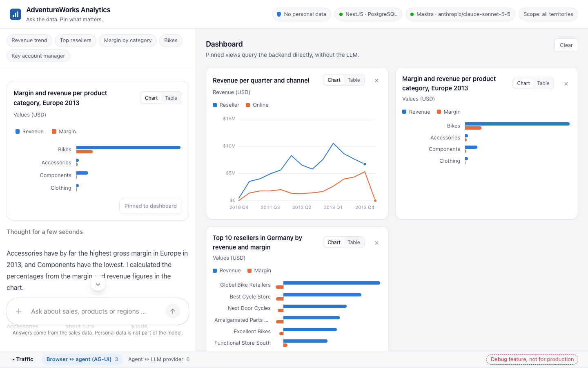
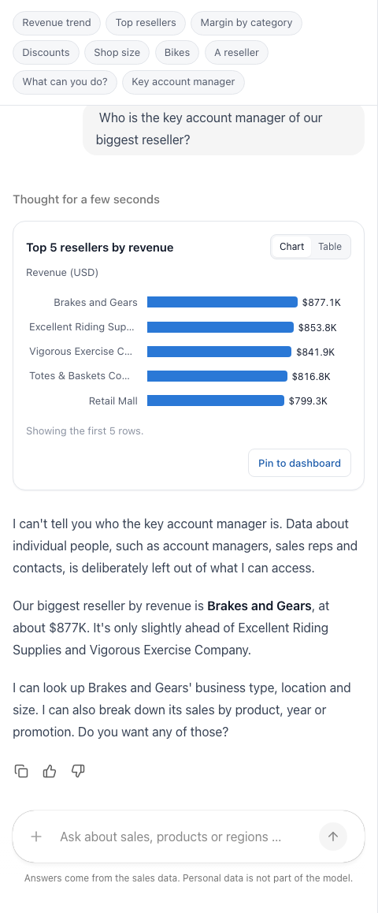

**The agent answers with Angular components, not with text: CopilotKit for Angular connects the app to the AG-UI endpoint, and every tool call becomes a chart, a table or a product card that you can pin to a dashboard.**

> **Agentic Analytics with Angular** is a series in four parts:
>
> 1. [Architecture, and keeping personal data out](/blog/2026-11-agentic-analytics)
> 2. The backend, as you prefer: [.NET with the Microsoft Agent Framework](/blog/2026-11-agentic-analytics-dotnet) or [Node.js with Mastra](/blog/2026-11-agentic-analytics-node)
> 3. **Generative UI in Angular with CopilotKit** (this article)
> 4. [Compare, watch and fine-tune the agent](/blog/2026-11-agentic-analytics-in-practice)

The backend from part 2, [.NET](/blog/2026-11-agentic-analytics-dotnet) or [Node.js](/blog/2026-11-agentic-analytics-node), serves the agent under `/agent` and the data under `/api`.
The Angular app does not care which one answers: both speak AG-UI and serve the same contract.

**What you get from this article:** how CopilotKit for Angular connects an app to any AG-UI agent without a CopilotKit server, three ways to turn the agent's answers into your own Angular components, charts that cannot mislabel what they show, a dashboard that runs without the model, and an overview of the alternatives to CopilotKit.



> The complete demo is on GitHub: [angular-schule/demo-agentic-analytics](https://github.com/angular-schule/demo-agentic-analytics).
> Copy `.env.example` to `.env` and `agent/.env.example` to `agent/.env`, add your API key, run `docker compose --profile node up` (or `--profile dotnet`), and open http://localhost:8080.

## Contents

[[toc]]

## What You Need from Parts 1 and 2

The Angular app talks to a backend that you can build in [part 2 with .NET](/blog/2026-11-agentic-analytics-dotnet) or [part 2 with Node.js](/blog/2026-11-agentic-analytics-node). For this article, it is enough to know what that backend offers:

- **`/agent`:** an AG-UI endpoint. The browser posts the conversation, and the agent answers with a stream of events: text in pieces, and *tool calls* with their arguments and results.
- **Two backend tools:** `querySales` takes a title, a chart kind (`line`, `bar`, `kpi` or `table`) and a query of measures, dimensions and filters, and returns columns and rows. `findProducts` returns products with a photo URL. Both run on the server; the browser only sees their results.
- **`/api`:** the same data without the model, e.g. `POST /api/sales/aggregate` for a query and the product photos.
- **No personal data:** the model can only ask for what the semantic layer offers, and that contains companies and products, but no people. [Part 1](/blog/2026-11-agentic-analytics) explains how the database enforces this.

Terms such as *tool*, *frontend tool* and *generative UI* are explained in [part 1](/blog/2026-11-agentic-analytics#the-vocabulary-in-five-minutes) and in the glossary at the end of this article.

## Layer 4: Angular with CopilotKit

| Frontend | CopilotKit for Angular |
| --- | --- |
| What it is | Chat components and APIs that connect an Angular app to an AG-UI agent and render tool calls as Angular components |
| Made by | CopilotKit (Tawkit, Inc.), a startup from Seattle founded in 2023 by Atai and Uli Barkai. MIT license. The Angular package `@copilotkit/angular` lives in the main repository and is at version 0.6, for Angular 22 |
| Why we need it | We get the chat, the streaming, and the binding between tool calls and our components, without writing an AG-UI client ourselves |
| Alternatives | Hashbrown, the Vercel AI SDK for Angular, an A2UI renderer, or your own AG-UI client. More on these below |

[CopilotKit](https://www.copilotkit.ai/) is not a Microsoft product; "Copilot" is a generic word here.
The libraries are open source under MIT. The company earns money with a commercial platform on top, which our demo does not use.
CopilotKit also started the AG-UI protocol, and its [Angular frontend](https://docs.copilotkit.ai/angular) is described as the "first-party, signal-based Angular frontend for AG-UI agents".

### Connecting the Agent

CopilotKit for Angular is configured with `provideCopilotKit()`.
We do not use CopilotKit's own runtime or cloud; the agent is an AG-UI endpoint, so an `HttpAgent` from `@ag-ui/client` is all it takes:

```ts
export const copilotKitConfig: CopilotKitConfig = {
  selfManagedAgents: {
    analyst: new HttpAgent({ url: '/agent/ag-ui/analyst' }),
  },
  renderToolCalls: [salesViewRenderer, productCardsRenderer],
  enableInspector: false,
};
```

In the template, the chat is one element:

```html
<copilot-chat [agentId]="agentId" />
```

### Three Ways to Generate UI

CopilotKit offers three ways to connect an Angular component to the agent.
Manfred summed up the difference nicely: with `registerComponent()` and `registerFrontendTool()`, **the model decides** to show something; with `registerRenderToolCall()`, **CopilotKit decides** to draw the result of a backend tool.

| API | Who defines the tool? | What happens? |
| --- | --- | --- |
| `registerComponent()` | the frontend | The model calls the tool *to show* the component and passes the data as arguments. |
| `registerFrontendTool()` | the frontend | The model calls the tool, the handler runs in the browser (and may render a component). |
| `registerRenderToolCall()` | the agent | A backend tool runs; the frontend only *draws* its arguments and result. |

All three are controlled generative UI in the sense of the table above: the components are ours, the agent only chooses and fills them.

Our charts use `registerRenderToolCall()`.
The tool runs on the server, and the component receives the arguments (title, chart type, query) and the result (the rows).
The model does not have to repeat the numbers as component arguments, which saves tokens and avoids transcription errors.

```ts
@Component({
  selector: 'app-sales-view-renderer',
  imports: [SalesChart],
  template: `
    @let call = toolCall();
    @if (result(); as result) {
      @if (view(); as view) {
        <app-sales-chart [title]="view.title" [kind]="view.chart" [result]="result" />
        <button type="button" [disabled]="pinned()" (click)="dashboard.pin(view)">Pin to dashboard</button>
      }
    } @else if (error(); as error) {
      <p class="error"><strong>No result.</strong> {{ error }}</p>
    } @else {
      <p class="loading">{{ call.args.title ?? 'Querying sales' }} …</p>
    }
  `,
})
export class SalesViewRenderer implements ToolRenderer<SalesView> {
  readonly toolCall = input.required<AngularToolCall<SalesView>>();
  // view(), result(), error(), pinned() are computed signals over toolCall()
}

export const salesViewRenderer: RenderToolCallConfig<SalesView> = {
  name: 'querySales',
  args: salesViewSchema,
  component: SalesViewRenderer,
};
```

`toolCall` is a signal input.
While the model is still streaming the arguments, `status` is `in-progress` and `args` is partial, so the title appears before the query is complete.
That is why every field is treated as optional until the call is complete.
When the call is complete, `result` holds the tool's answer as a JSON string: either the rows, or an error message from `orError()` or from Mastra's schema check, which the card shows instead of the chart.

Pinning works both ways: by button, and by asking the agent ("Please pin that chart to the dashboard").
For the second, the frontend registers a tool that runs in the browser.
CopilotKit sends its name and schema to the agent with every request. When the model calls it, CopilotKit runs the handler in the browser and starts a follow-up run with the handler's answer, so the model can confirm it:

```ts
registerFrontendTool({
  name: 'pinToDashboard',
  description: 'Pins a view to the dashboard next to the chat. Only when the user asks for it.',
  parameters: salesViewSchema,
  handler: async (view) => {
    // CopilotKit passes the model's arguments as parsed JSON, without checking them against the schema.
    const parsed = salesViewSchema.safeParse(view);
    if (!parsed.success) return `Not pinned, the view is invalid: ${parsed.error.message}`;
    return dashboard.pin(parsed.data)
      ? `Pinned "${parsed.data.title}" to the dashboard.`
      : 'This view is already on the dashboard.';
  },
});
```

The handler validates again, and that is a trap worth knowing: the Zod schema describes the tool for the model, but CopilotKit does not validate the arguments.
Without the check, a single malformed pin is stored as is, and on the next page load, the dashboard validates the tiles it stored in `localStorage` and discards *all* of them.
**Treat everything the model sends as untrusted input**, just like a form submitted from the internet.

### Charts: Label What Is Plotted

The charts are plain Angular components (bars in HTML and CSS, lines in SVG) with tooltips, a legend for several series, a colour palette that works for colour-blind readers, and a switch to a table view.
No chart library is needed for that.

A typical trap in generative UI: ask for "the gross margin of the product categories in Europe in 2013", and the model requests revenue *and* margin and titles the chart "Gross margin by product category".
A chart that simply plots the first measure then shows revenue under a margin title, while the text answer below is correct.

Two things prevent that here: the tool description tells the model that the first measure is plotted, and the chart does not guess.
Measures with the same unit are drawn side by side, and the chart always says what it shows ("Revenue (USD)", "Values (USD)"), taken from the query and not from the title.

The text answer below the chart is a different matter: the numbers in the chart come from the database, while the short analysis comes from the model and can misstate a number or see a trend that is not there. Nothing checks it, so the chart is what counts.

### Dashboard: Running Without the Model

A pinned tile is a `SalesView`: title, chart type, query.
It is stored in `localStorage`, so in the demo each browser has its own dashboard; a real project would store the views on the server per user or team. Each tile is loaded with `httpResource()` directly from the backend:

```ts
protected readonly data = httpResource<AggregateResponse>(() => ({
  url: '/api/sales/aggregate',
  method: 'POST',
  body: this.tile().query,
}));
```

Manfred calls this the difference between *design mode* and *runtime mode*: the agent helps to design the view once, and from then on it runs like any other report.

### Alternatives to CopilotKit

CopilotKit is not the only way to bring an agent into an Angular app.
These are the options I would look at:

| Library | Maker, license | Frameworks | How it works |
| --- | --- | --- | --- |
| [CopilotKit](https://docs.copilotkit.ai/angular) | CopilotKit, MIT | Angular, React, Vue | Chat and tool rendering for an agent on the server, over AG-UI |
| [Hashbrown](https://hashbrown.dev/) | LiveLoveApp, MIT | Angular, React | Headless: the model renders your registered components and calls tools that run in the browser. A thin server adapter keeps the API key and streams AG-UI events |
| [Vercel AI SDK UI](https://ai-sdk.dev/docs/getting-started/angular) | Vercel, Apache 2.0 | React, Vue, Svelte, Angular (`@ai-sdk/angular`) | Chat state and streaming for a backend built with the AI SDK; no ready-made chat components for Angular |
| [A2UI renderer](https://github.com/a2ui-project/a2ui) | started by Google, Apache 2.0 | Angular, Lit, React, Flutter | Renders declarative UI descriptions from the agent with your component catalogue; needs a transport such as AG-UI |
| [assistant-ui](https://www.assistant-ui.com/) | AgentbaseAI, MIT | React | Chat components for React with an AG-UI adapter; for Angular teams only relevant in a React micro-frontend |
| Your own AG-UI client | you | any | `@ag-ui/client` plus a few signals; you write the chat UI yourself |

The main difference is where the agent lives.
Hashbrown runs the agent loop in the browser: tools have direct access to your services and state, and the server only holds the API key.
CopilotKit connects the Angular app to an agent on the server.
That is the right choice when tools need database access that must never reach the browser, as in our demo.

The Angular team itself does not offer a chat or generative UI library; [angular.dev/ai](https://angular.dev/ai) points to Genkit, Firebase AI Logic and the Gemini API for AI features.

One thing to plan for: CopilotKit is not small.
It brings Markdown rendering, syntax highlighting, KaTeX and web components, and the initial bundle of the demo is about 1.5 MB compressed.
In my opinion, that is fine for an internal analytics tool, but not for a public landing page.

## Test: Who Is the Key Account Manager?

Time for the question the whole data layer was built for.
The chat offers a few example questions above the input field. One of them is "Who is the key account manager of our biggest reseller?":



The wording changes from run to run, the content does not: no names of people, but an offer to analyse the reseller as a company.
In some runs, the agent went on right away, called `querySales`, showed the top 10 resellers as a bar chart, and named the biggest one: Brakes and Gears, with $877K from 12 orders.
That is exactly the line we drew: **company names yes, people no.**
And if the model had tried anyway, there would have been nothing to find.

## How the Series Continues

With that, the app is complete: a chat that answers with Angular components, a dashboard that keeps them, and a data layer that keeps people out.
[Part 4](/blog/2026-11-agentic-analytics-in-practice) takes a step back and looks at the app in practice. Are Mastra and the Microsoft Agent Framework really equivalent? A traffic window shows every message between browser, agent and LLM provider, and with it, the defaults that each framework sends without asking. One of them, together with a single well-meant sentence in the prompt, made every third or fourth answer come back in German. Part 4 shows how I tracked it down, and how to test an agent without paying for a single token.

## Glossary

The terms of this part. The full glossary of the series, including the names that each framework uses, is in [part 1](/blog/2026-11-agentic-analytics#glossary).

| Term | Meaning | Also known as |
| --- | --- | --- |
| **Token** | The unit in which a model reads and writes text, a few characters each; the basis for billing and output limits | – |
| **System prompt** | Standing instructions that apply to the whole conversation | Instructions. OpenAI: also *developer* messages. In Microsoft.Extensions.AI, a message with `ChatRole.System` |
| **Tool** | A function described to the model by name, description and JSON schema | OpenAI: function tool. Anthropic: tool use, "also called function calling" |
| **Tool call** | The model's request to run a tool with certain arguments | OpenAI: function call. AG-UI: the events `TOOL_CALL_START`, `TOOL_CALL_ARGS`, `TOOL_CALL_END`, `TOOL_CALL_RESULT` |
| **Backend tool** | A tool that runs on the server, next to the agent | Server-side tool. Not to be confused with Anthropic's *server tools* (see *Provider-run tool* below) |
| **Provider-run tool** | A tool that the LLM provider runs on its own infrastructure, e.g. web search | Anthropic: server tools, as opposed to *client tools*, which run in your application (backend included). Vercel AI SDK: provider-executed tools |
| **Tool rendering** | The frontend draws a tool call and its result as a component | Tool call rendering |
| **Agent** | An LLM in a loop with tools and instructions | |
| **Agent framework** | A library that runs the loop, the tools, streaming and the model connection | Mastra, Microsoft Agent Framework, LangGraph, Vercel AI SDK, Google ADK and others |
| **Generative UI** | User interface that the agent's answer produces, beyond text | |
| **AG-UI** | Protocol between app and agent: events over HTTP | Agent-User Interaction Protocol, started by CopilotKit, see [the protocols](/blog/2026-11-agentic-analytics#the-protocols-ag-ui-a2ui-mcp-and-a2a) |
| **A2UI** | Format for a declarative UI description | started by Google |
| **SSE** (server-sent events) | An HTTP response that stays open and delivers one event after another | Web standard (`EventSource`); AG-UI's HTTP client receives its events this way |
| **Measure** | A number that is aggregated with a fixed formula, e.g. revenue | The same in dbt, Cube, Looker and Power BI; dbt builds *metrics* on top of measures |
| **View** | A stored `SELECT` that the database offers like a table | SQL standard |
