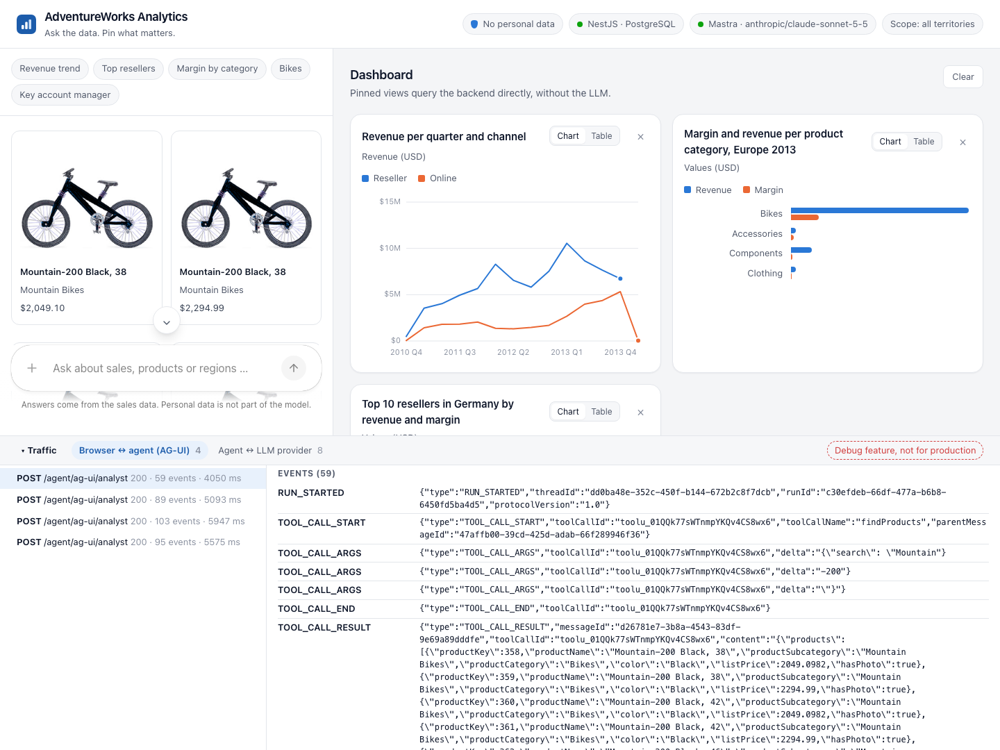
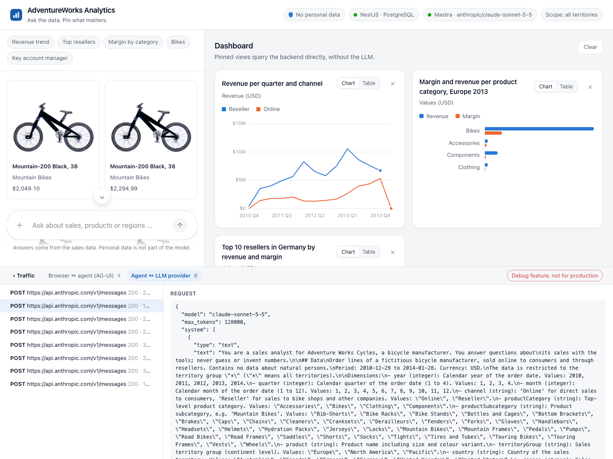

**Two agent frameworks, one app, the same answers? Mostly. The differences hide in defaults that you only see when you watch the traffic, and a single well-meant sentence in the prompt can make the model switch languages.**

> **Agentic Analytics with Angular** is a series in four parts:
>
> 1. [Architecture, and keeping personal data out](/blog/2026-11-agentic-analytics)
> 2. The backend, as you prefer: [.NET with the Microsoft Agent Framework](/blog/2026-11-agentic-analytics-dotnet) or [Node.js with Mastra](/blog/2026-11-agentic-analytics-node)
> 3. [Generative UI in Angular with CopilotKit](/blog/2026-11-agentic-analytics-angular)
> 4. **Compare, watch and fine-tune the agent** (this article)

The first three parts built the app: the data layer, the backend with the agent, and the Angular UI.
This last part looks at it in practice: how the two frameworks compare, how to choose another framework or model, how to watch every message, why you should not settle for the first result, and how to test an agent without a model.

**What you get from this article:** a comparison of two agent frameworks that goes beyond feature lists, a technique to see exactly what your agent sends to the model, a real case in which one sentence in the prompt changed the answer language, and a way to test agents without cost and with repeatable results.

> The complete demo is on GitHub: [angular-schule/demo-agentic-analytics](https://github.com/angular-schule/demo-agentic-analytics).
> Copy `.env.example` to `.env` and `agent/.env.example` to `agent/.env`, add your API key, run `docker compose --profile node up` (or `--profile dotnet`), and open http://localhost:8080.

## Contents

[[toc]]

## What You Need from Parts 1 to 3

The demo app is a chat in Angular in which questions about sales data become charts that you can pin to a dashboard. This article refers to it as follows:

- **Two agents, one app:** the same agent exists twice, with the [Microsoft Agent Framework in ASP.NET Core](/blog/2026-11-agentic-analytics-dotnet) and with [Mastra in NestJS](/blog/2026-11-agentic-analytics-node). Both get the same system prompt and the same tools, `querySales` for the sales data and `findProducts` for the product catalogue. The tool schemas are generated from the *semantic layer*, a fixed list of measures and dimensions, so the model only knows names that exist.
- **AG-UI:** the agent streams events to the Angular app, which draws tool calls as components with CopilotKit ([part 3](/blog/2026-11-agentic-analytics-angular)). The browser adds its own *frontend tool*, `pinToDashboard`.
- **The model:** Claude Sonnet 5.5 by default, set with `MODEL` and the provider's API key in `agent/.env`.
- **Path A and path B:** the agent runs inside the backend, or as a separate Mastra service in front of either backend ([path B](/blog/2026-11-agentic-analytics-node#path-b-the-agent-as-a-separate-service)).
- **No personal data:** the database views contain no column about people, which [part 1](/blog/2026-11-agentic-analytics) explains in detail. Whatever a tool returns goes to the LLM provider.

You can read this article on its own; the links lead to the details.

## Mastra and the Agent Framework in Practice

### Mastra or the Agent Framework: Are They Equivalent?

Are the two equivalent? For this app, yes.
The Angular app does not know which framework answers; only the status line in the header shows it.
With the same model (Claude Sonnet 5.5), the same prompt and the same tools, both agents answered the example questions above the chat's input field in the same way.
The quarterly revenue per channel became a line chart, the Mountain-200 (a mountain bike in the AdventureWorks catalogue) became product cards, and the question about the key account manager got the polite refusal that [the test in part 3](/blog/2026-11-agentic-analytics-angular#test-who-is-the-key-account-manager) looks at in detail.
Pinning a chart by chat (a frontend tool, see [part 3](/blog/2026-11-agentic-analytics-angular#three-ways-to-generate-ui)) works with both, including the confirmation after the frontend tool has run.
The texts differ from run to run, as they do with the same framework, too.

That is no coincidence: both frameworks are built from the same parts.
An agent has instructions, tools and a model, a loop calls tools until the answer is complete, and the result streams to the browser over AG-UI.
Beyond what this demo uses, both also offer workflows with explicit steps, memory for conversations, MCP clients and telemetry.

What differs is the work around it:

| | Mastra | Microsoft Agent Framework |
| --- | --- | --- |
| Languages | TypeScript | C#, Python, Go (preview) |
| Model access | a model router: one string per model, e.g. `anthropic/claude-sonnet-5-5` | an `IChatClient` from Microsoft.Extensions.AI, created by the provider's SDK |
| Tool schema | written by hand in Zod | derived from C# types, adjusted in a callback (enums, optional without `null`) |
| Validation of tool arguments | Mastra checks against the Zod schema | deserialization into the C# types; names are checked by the semantic layer |
| AG-UI | adapter package plus a few lines of streaming | `MapAGUIServer()`, a preview package (`1.27.0-preview`) at the time of writing |
| Trying agents locally | Mastra Studio, a local web UI | DevUI, a preview package |
| Origin | Kepler Software, 1.0 in January 2026 | Microsoft, direct successor of Semantic Kernel and AutoGen |
| License | Apache 2.0, except the source-available `ee/` folders | MIT |

So the choice follows your backend: a Node.js team takes Mastra, a .NET team the Agent Framework.
The differences that matter most are invisible at first: the defaults with which each framework talks to the model. The section [Fine-Tuning: Do Not Settle for the First Result](#fine-tuning-do-not-settle-for-the-first-result) shows how much they can change.
None of these differences is a reason to switch the backend language, and with path B you can even combine a .NET backend with a Mastra agent.


### Choosing Another Agent Framework

Which framework fits depends mostly on your language and on whether it speaks AG-UI, because then the Angular side stays the same:

| Framework | Maker | Languages | AG-UI |
| --- | --- | --- | --- |
| [Mastra](https://mastra.ai/) | Kepler Software | TypeScript | yes, `@ag-ui/mastra` |
| [Microsoft Agent Framework](https://learn.microsoft.com/en-us/agent-framework/overview/) | Microsoft | C#, Python, Go (preview) | yes |
| [LangGraph](https://www.langchain.com/langgraph) | LangChain | Python, TypeScript | yes |
| [Vercel AI SDK](https://ai-sdk.dev/) | Vercel | TypeScript | yes, via `@ag-ui/vercel-ai-sdk` |
| [Google ADK](https://google.github.io/adk-docs/) | Google | Python, TypeScript, Go, Java | yes |
| [AWS Strands Agents](https://strandsagents.com/) | AWS | Python, TypeScript | yes |
| [OpenAI Agents SDK](https://openai.github.io/openai-agents-js/) | OpenAI | TypeScript, Python | in progress |
| [Pydantic AI](https://ai.pydantic.dev/) | Pydantic | Python | yes |

### Switching the Model

| Model | Claude, GPT, Gemini or Mistral |
| --- | --- |
| What it is | The LLM that reads the conversation and decides which tool to call |
| Made by | Anthropic, OpenAI, Google, Mistral AI, each with a commercial API |
| Why we need it | It turns a question in plain language into a structured query and comments on the result |
| Alternatives | Any provider with an SDK for your agent framework, or an open-weight model on your own hardware via Ollama or vLLM |

Mastra has a [model router](https://mastra.ai/models): the model is a single string like `anthropic/claude-sonnet-5-5`, `openai/gpt-5.6-terra` or `google/gemini-3-flash-preview`, and the API key comes from the provider's usual environment variable.
In the Microsoft Agent Framework, you swap the `IChatClient`: the demo's .NET backend creates one from Anthropic's SDK or, for `MODEL=openai/…`, from OpenAI's SDK through the package `Microsoft.Extensions.AI.OpenAI`.
The demo wires Google and Mistral only on the Node.js track; in .NET, Gemini works through Google's own SDK or its OpenAI-compatible endpoint, the demo just does not include it.
Either way, the setting is one line (`MODEL`) plus the provider's API key in `agent/.env`, which both backends and the separate agent service read.
How well the agent works depends on the model: it has to pick the right tool, fill the query schema correctly and stick to the rules of the system prompt.
Try your questions with two or three models before you decide.

## Watching the Traffic

For learning, the most useful part of the demo is a debug feature: below the chat and the dashboard, a traffic window shows every message on both connections, in two tabs:

- **Browser ↔ agent (AG-UI):** the `RunAgentInput` that the browser posts, with the whole conversation and the frontend tools, and every event that comes back: `RUN_STARTED`, the tool call arriving piece by piece in `TOOL_CALL_ARGS`, the result (`TOOL_CALL_RESULT`), the pieces of text (`TEXT_MESSAGE_CONTENT`) and `RUN_FINISHED`.
- **Agent ↔ LLM provider:** the request in the provider's own format, with the system prompt, the tool schemas and the tool results, and the streamed answer. This is what the model really gets, including the defaults that the framework adds.





Each part is built in the language of its layer:

- **Angular:** `HttpAgent` accepts a `fetch` function. The demo's version passes the request through unchanged and reads a copy of the event stream (`ReadableStream.tee()`).
- **Node.js:** a small proxy on a free port of 127.0.0.1, in the same process. Mastra's model router reads each provider's address from an environment variable (`ANTHROPIC_BASE_URL`, `OPENAI_BASE_URL`, `GOOGLE_BASE_URL`, `MISTRAL_BASE_URL`), so pointing these at the proxy is enough, and the agent code stays unchanged. The proxy forwards each request to the address that was configured before, so the EU endpoints work with the window, too.
- **.NET:** the Anthropic SDK accepts `DelegatingHandler`s for its HTTP pipeline (`Handlers` on the client), and OpenAI's SDK accepts an `HttpClient` as its transport. The same handler sits in both: it records the request body and the streamed answer while passing both through.

Headers, and with them the API key, are never recorded.

> **Debug feature, not for production.** The window shows the system prompt, every tool result and the whole conversation to whoever opens the app. It is on by default because the demo is meant for learning. Switch it off with `DEBUG_TRAFFIC=off` in `agent/.env`, and remove everything marked `DEBUG ONLY` from a production application.

The window pays off quickly.
In every answer from Anthropic, the `usage` block contains `"inference_geo": "global"`.
According to [Anthropic's documentation](https://platform.claude.com/docs/en/manage-claude/data-residency), that is the default, and it means that "inference may run in any available geography".
The only alternative is `"us"`; there is no EU option on Anthropic's own API at the time of writing.
That is exactly the kind of detail your data protection officer will ask about, and one you would never see in the chat. Part 1's section [What Goes to the LLM Provider?](/blog/2026-11-agentic-analytics#what-goes-to-the-llm-provider) shows the way out.

## Fine-Tuning: Do Not Settle for the First Result

When the demo ran for the first time, both agents gave good answers, and it would have been easy to stop there.
But an agent has many switches, and several of them change the result considerably: the wording of the system prompt, the tool descriptions, which tools are offered, how tool results are serialized, the token limit and of course the model.
Some of these switches you set yourself.
Others are defaults of the framework or the SDK that you never see unless you look at the request that actually goes to the provider.
So take the time to try the same question many times and with small changes before you trust the result.

### Example: The Answer Language

The system prompt contained a well-meant rule: "Answer in the language of the user's latest message."
With the Agent Framework, every third or fourth answer to an English question came back in German, with German date formats like 29.12.2010.
Nothing in the request was German.
With Mastra, the same prompt did not produce a single German answer in my runs.

Did Mastra add a hidden instruction?
To find out, I recorded what both agents send to the Anthropic API, the same way the [traffic window](#watching-the-traffic) does.
The answer: no hidden prompt. The system prompt was identical, character for character.
The differences were in the details:

| | Mastra | Microsoft Agent Framework |
| --- | --- | --- |
| Output limit (`max_tokens`) | 128,000 | 1,024, the default of Anthropic's `IChatClient` adapter when the request sets no limit |
| Tool results | compact JSON | indented JSON, written with the default options of Microsoft.Extensions.AI |
| Tool definitions | from the Zod schemas | generated from the C# types |

Then I sent the recorded requests straight to the API, changed one detail at a time, and repeated each variant 24 times.
With the language rule, the share of German answers ranged from none to four out of five, depending on details that have nothing to do with language: whether the frontend tool was in the list, whether the query had a sort order, how the JSON was indented.
Mastra's request happened to land on the safe side, the Agent Framework's did not.
Give Mastra's request the tool definitions, the indented JSON and the token limit of the Agent Framework, and it answers in German just as often.
So this is not a weakness of one framework: the rule itself made the model unstable, and the framework details only decided how often it showed.
Why the model picks German of all languages is unknown.

The solution was to delete the rule.
Without it, in my runs both agents answered every English question in English and every German or Spanish question in German or Spanish.
Current models do this by themselves, and the rule only added a way to get it wrong.

The .NET agent keeps two of the changes anyway.
Tool results go to the model as compact JSON, which saves tokens, and the Anthropic client gets its own output limit, because 1,024 tokens can cut off a longer answer:

```csharp
AIFunctionFactoryOptions Tool(string name) => new()
{
    Name = name,
    SerializerOptions = Json,
    JsonSchemaCreateOptions = schemaOptions,
    MarshalResult = (result, type, _) => new(JsonSerializer.Serialize(result, type ?? typeof(object), Json)),
};

new AnthropicClient { ApiKey = model.ApiKey }
    .AsIChatClient(model.Name)
    .AsBuilder()
    .ConfigureOptions(options => options.MaxOutputTokens ??= 8192)
    .Build();
```

### Example: A Rule Is a Wish

The description of `querySales` says: "The user sees the visualization right away, so do not repeat the numbers as a table in the answer; comment on what stands out instead."
Usually the model sticks to it.
But while I took the screenshots for this series, it answered the question about the margin per product category with the bar chart *and* a Markdown table of the same numbers below it.
Nothing was wrong with the request; the model simply decided otherwise this time.

A rule in the prompt raises the probability of a behaviour, it does not guarantee it.
Whatever must hold every time belongs in code: the semantic layer decides which data exists, the Zod schema decides which chart requests the app accepts, and the database decides which rows a connection sees.
For the rest, such as the length and form of the comment, the prompt is the right place, and an occasional table is a cosmetic slip, not a failure.

What I take from this:

- **Look at the real request.** What the framework sends is not what you wrote. Defaults like the token limit or the JSON format only show up there.
- **One run says nothing.** Ask the same question many times and change one thing at a time. A behaviour that shows up in every fourth answer slips through a quick manual test.
- **Fewer rules are often better.** Every rule in the prompt is something the model can misapply. Keep the rules that the model cannot know by itself, such as the ones about personal data.
- **Enforce in code what must always hold.** A prompt rule is a wish. The guarantees come from the semantic layer, the schemas and the database.

## Testing an Agent Without a Model

An agent is hard to test against a real model: every answer costs tokens and is a little different.
The demo therefore tests against a fake LLM: a small Node.js server that imitates Anthropic's Messages API and answers with scripted tool calls and texts.
Both agent frameworks read the provider's address from `ANTHROPIC_BASE_URL`, so a Compose override (`compose.test.yaml`) points every agent at the fake, without touching the agent code.
The tests run on every layer:

- **Agents:** every agent (the Microsoft Agent Framework in ASP.NET Core, Mastra in NestJS and Mastra as a separate service) answers the same AG-UI requests. The tests check that a question becomes a `querySales` call whose result matches the HTTP API, that the frontend tool is left to the browser, that a rejected request comes back as a tool error, what the model receives (rules, tools, compact tool results, token limit), that the traffic window records the exchange without the API key, and that stopping a run stops the model.
- **Contract:** both backends publish the same OpenAPI document and give the same answers, as described in [part 1](/blog/2026-11-agentic-analytics#two-backends-one-contract).
- **Angular:** unit tests with Vitest through `ng test`, e.g. for the view schema (optional is not nullable), the chart model and the dashboard.
- **Browser:** Playwright drives the app: chart, pinning by button and by chat, the dashboard after a reload without a single request to the model, the product photos and the traffic window.

The fake LLM also made a few differences between the frameworks visible that you would hardly notice in the chat:

- **Optional parameters.** In C#, a parameter without a default value is required in the generated schema, even if its type is nullable. The .NET tool `findProducts` demanded a `limit` that the Mastra tool treats as optional. A default value (`int? limit = null`) fixes it.
- **Rejected names.** Mastra rejects an unknown measure against the Zod schema before the tool runs; the .NET tool lets the semantic layer reject it. Both tell the model which measures exist, in different words.
- **Streaming of tool arguments.** Mastra forwards the arguments of a tool call piece by piece (`TOOL_CALL_ARGS` many times); the Agent Framework sends them in one piece. The chat card can show the title earlier with Mastra; the result is the same.

## What This Demo Leaves Out

A few directions go further than this demo, and I deliberately skipped them:

- **Shared agent state** (AG-UI's `STATE_SNAPSHOT` and `STATE_DELTA`), where the agent itself edits the dashboard, e.g. "change every tile to a bar chart".
- **A2UI**, so the agent can assemble UI from a catalogue of components at runtime.
- **JSONata** as a sandbox in which the model can compute derived figures.
- **Human-in-the-loop** approvals for large queries.

The workshop that inspired this series, mentioned in [part 1](/blog/2026-11-agentic-analytics#inspired-by-manfred-steyer), shows several of them. In my opinion, that is the natural next step after this series.

## Conclusion

Agentic analytics with Angular works today, and it works with the stacks we already use.
The technology choice looks confusing at first, but each piece has one job: the model decides, Mastra or the Microsoft Agent Framework runs the loop and the tools, AG-UI carries the events, CopilotKit draws them as Angular components, and the backend and the database decide what data exists at all.
Every piece can be replaced on its own.

Six architectural decisions make the app work:

1. **Put the agent where your team already works.** In the existing backend (path A), with the agent framework of its language, or as a separate service (path B) when several backends share it.
2. **Keep personal data out of the views**, enforced by the database, not by the prompt.
3. **Give the model a semantic layer instead of SQL.** Typed in C# or TypeScript, validated on the server.
4. **Let the agent call tools, and let Angular draw them.** CopilotKit and AG-UI do the plumbing.
5. **Treat model output as untrusted input**, and let components decide what is true.
6. **Pin the result** and run it without the model from then on.

The complete code with both backends and both paths is on GitHub: **[angular-schule/demo-agentic-analytics](https://github.com/angular-schule/demo-agentic-analytics)**.
Clone it, copy the two `.env.example` files, add your API key, run `docker compose --profile node up` or `docker compose --profile dotnet up`, open http://localhost:8080, and ask your own questions.

How do you keep personal data away from your agents? I'm curious about your approaches, so let me know.

## Glossary

The full glossary with every term of the series is in [part 1](/blog/2026-11-agentic-analytics#glossary). The same idea often has a different name in each framework, and sometimes the same name means different things.
A dash means that the framework has no name of its own for it or that this series does not use it.

| Concept | Mastra | Microsoft Agent Framework (.NET) | AG-UI | CopilotKit | Vercel AI SDK |
| --- | --- | --- | --- | --- | --- |
| **LLM** | `model`, a string like `anthropic/claude-sonnet-5-5` | `IChatClient` from Microsoft.Extensions.AI | – | – | `model` |
| **System prompt** | `instructions` | `instructions` | – | – | `instructions` |
| **Agent** | `Agent` | `AIAgent`, concretely `ChatClientAgent` | agent; `HttpAgent` on the client | agent | `ToolLoopAgent` |
| **Tool** | tool, `createTool()` | `AIFunction`, created with `AIFunctionFactory` | tool | – | tool, `tool()` |
| **Backend tool** | a tool with an `execute` function | backend tool | backend tool | *server tool* for its built-in agent, *backend tool call* for an external agent | server-side tool |
| **Frontend tool** | client tool (`clientTools`) | frontend tool | frontend tool, also client-defined tool | frontend tool, `registerFrontendTool()` | client-side tool |
| **Tool rendering** | – | backend tool rendering | backend tool rendering | tool call rendering, `registerRenderToolCall()` | – |
| **Generative UI** | – | tool-based and agentic generative UI | static and declarative generative UI | controlled, declarative and open-ended generative UI | the result of a tool call rendered as a component |
| **Shared state** | – | – | state, sent with `STATE_SNAPSHOT` and `STATE_DELTA` | shared state, agent state | – |
| **Human-in-the-loop** | `requireApproval` | `ApprovalRequiredAIFunction` | interrupts | `registerHumanInTheLoop()` | `toolApproval` |
| **Trying agents locally** | Mastra Studio | DevUI (preview) | – | – | – |

Two names are easy to mix up.
**"Server tool"** means a tool on your server in CopilotKit, but a tool that Anthropic runs on its own servers in the Anthropic API.
**"Client tool"** means a tool in the browser in Mastra, but any tool that runs in your application, the backend included, in the Anthropic API.
