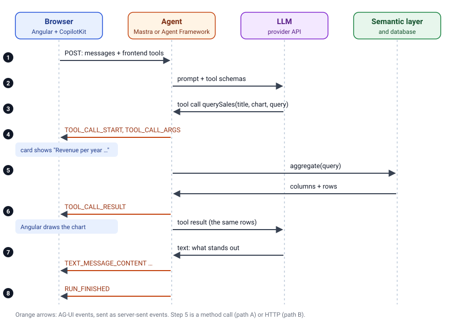

**In NestJS, the semantic layer is a list of Drizzle columns and SQL fragments, and the agent is a Mastra object with Zod schemas that speaks AG-UI through a small adapter.**

> **Agentic Analytics with Angular** is a series in four parts:
>
> 1. [Architecture, and keeping personal data out](/blog/2026-11-agentic-analytics)
> 2. The backend, as you prefer: [.NET with the Microsoft Agent Framework](/blog/2026-11-agentic-analytics-dotnet) or **Node.js with Mastra** (this article)
> 3. [Generative UI in Angular with CopilotKit](/blog/2026-11-agentic-analytics-angular)
> 4. [Compare, watch and fine-tune the agent](/blog/2026-11-agentic-analytics-in-practice)

[Part 1](/blog/2026-11-agentic-analytics) built the data layer: views without personal data, row-level security that fails closed, and the idea of a semantic layer instead of text-to-SQL.
This part builds the Node.js track on top of it: NestJS, Drizzle and PostgreSQL, with Mastra as the agent, first inside the backend (path A) and then as a separate service (path B).
If your team works with .NET, read [part 2 for .NET](/blog/2026-11-agentic-analytics-dotnet) instead; both lead to the same Angular app in part 3.

**What you get from this article:** a semantic layer in TypeScript with Drizzle, an agent with Mastra whose tool schemas are generated from that layer, so the model only knows names that exist, and an AG-UI endpoint in NestJS. Plus two pitfalls that are easy to miss, and the same agent as a separate service for teams that want it independent of the backend.

> The complete demo is on GitHub: [angular-schule/demo-agentic-analytics](https://github.com/angular-schule/demo-agentic-analytics).
> Copy `.env.example` to `.env`, and `agent/.env.example` to `agent/.env` with your API key (without it, a demo model answers by keywords, no LLM needed), run `docker compose --profile node up`, and open http://localhost:8080.

## Contents

[[toc]]

## What You Need from Part 1

[Part 1](/blog/2026-11-agentic-analytics) explains the architecture and why every decision keeps personal data away from the model. In short:

- **The app:** an Angular chat in which questions about sales data become charts, and a dashboard of pinned charts that runs without the LLM.
- **The agent:** an LLM in a loop with *tools*, functions it may call. It never writes SQL. It calls `querySales` with a structured query and `findProducts` for the product catalogue; the frontend adds a third tool, `pinToDashboard`.
- **The semantic layer:** a fixed list of *measures* (revenue, cost, margin, quantity, orders) and *dimensions* (year, quarter, country, reseller, …). The backend turns a JSON request into parameterized SQL and rejects every other name.
- **The data:** AdventureWorksDW, read through views in the schema `analytics` that contain no column about people, with a read-only account. Row-level security (`DATA_SCOPE`) limits each connection to one territory group and shows nothing if the value is missing.
- **The contract:** both backends serve the same HTTP API under `/api`, described with OpenAPI.
- **AG-UI:** the protocol between the Angular app and the agent, events streamed as server-sent events.
- **Path A and path B:** the agent runs inside the existing backend (path A, as in this article) or as a separate service (path B, at the end of this article).

The layer numbers in the headings follow [the stack in part 1](/blog/2026-11-agentic-analytics#the-stack-from-bottom-to-top): data (1), semantic layer (2), agent (3), Angular (4).

If any of these is new to you, part 1 and its glossary are worth the detour; this article builds on them without repeating the reasons.

## Layer 2: The Semantic Layer with Drizzle

| Backend | NestJS with Drizzle |
| --- | --- |
| What it is | A small HTTP API that turns a JSON query into safe, parameterized SQL |
| Made by | the NestJS team (MIT), the Drizzle Team (Apache 2.0) and Rasmus Porsager (postgres.js, Unlicense) |
| Why we need it | The model never writes SQL. The backend decides which measures and dimensions exist and checks every request |
| Alternatives | Any backend you know: Spring Boot, Express, Fastify, Go. For data access: Dapper, Prisma, Kysely, TypeORM. Dedicated semantic layers such as Cube or dbt's MetricFlow do the same job as a product |

In NestJS, [Drizzle](https://orm.drizzle.team/), a TypeScript ORM, builds the parameterized SQL from the request.
The views are declared as existing views, and the dimensions point to Drizzle columns:

```ts
{ name: 'country', label: 'Country', description: 'Country of the sales territory.', isNumeric: false, isTime: false, listValues: true, column: sales.salesTerritoryCountry },
```

Each measure carries its SQL fragment, built with Drizzle's `sql` template tag, so columns are interpolated by Drizzle and nothing is concatenated as text:

```ts
{
  name: 'margin', label: 'Gross margin', description: 'Revenue minus product cost.', unit: 'USD',
  sql: sql<number>`round(coalesce(sum(${sales.salesAmount}), 0) - coalesce(sum(${sales.totalProductCost}), 0), 2)`.mapWith(Number),
},
```

## Layer 3: The Agent with Mastra

The agent is the part that talks to the model.
It has a system prompt, two backend tools (`querySales` for the semantic layer, `findProducts` for the product catalogue), and the Angular app adds a third, `pinToDashboard` ([part 3](/blog/2026-11-agentic-analytics-angular#three-ways-to-generate-ui)).
On path A, it lives in the backend, here in NestJS.

| Agent (Node.js track) | Mastra |
| --- | --- |
| What it is | A TypeScript framework for agents: tools with schemas, the agent loop, a model router for many providers, plus workflows, memory, evals and observability that this demo does not need |
| Made by | Kepler Software, Inc. in San Francisco, founded by people from the Gatsby team, Y Combinator Winter 2025; version 1.0 since January 2026. Apache 2.0, except the `ee/` folders |
| Why we need it | It runs the loop between model and tools, validates the tool arguments, and speaks AG-UI through the adapter `@ag-ui/mastra` |
| Alternatives | Vercel AI SDK, LangGraph, OpenAI Agents SDK, Google ADK, AWS Strands Agents |

### Who Makes Mastra?

[Mastra](https://mastra.ai/) is made by Kepler Software, Inc., a company from San Francisco.
Its founders [built Gatsby](https://www.ycombinator.com/companies/mastra), the React web framework, before they started on Mastra in October 2024.
Mastra went through Y Combinator in Winter 2025 and [released version 1.0 in January 2026](https://mastra.ai/blog/announcing-mastra-1).

For a TypeScript developer, Mastra feels familiar: tools are objects with a [Zod](https://zod.dev/) schema, agents are objects with instructions, tools and a model, and everything is plain TypeScript.
The framework is Apache 2.0, with one exception: everything in folders named `ee/` (enterprise features such as parts of the authentication) is under a separate, source-available license that does not allow production use without a contract. Our demo does not use those parts.

### Tools Generated from the Semantic Layer (Mastra)

The agent builds its tool schemas from the semantic layer, the same data that `GET /api/schema` returns.
Dimension and measure names become enums in Zod. The model sees exactly the names that exist, and Mastra rejects any other name before the tool runs:

```ts
const dimensionNames = schema.dimensions.map((d) => d.name) as [string, ...string[]];
const measureNames = schema.measures.map((m) => m.name) as [string, ...string[]];

const querySales = createTool({
  id: 'querySales',
  description: `
    Aggregates the sales data and shows the result to the user as a chart, table or key figure.
    The user sees the visualization right away, so do not repeat the numbers as a table in the answer;
    comment on what stands out instead.
    Put the measure the title is about first. ...
  `,
  inputSchema: z.object({
    title: z.string(),
    chart: z.enum(['bar', 'line', 'table', 'kpi']),
    query: z.object({
      measures: z.array(z.enum(measureNames)).min(1),
      groupBy: z.array(z.enum(dimensionNames)).max(schema.limits.maxGroupBy).optional(),
      // filters, orderBy, limit ...
    }),
  }),
  execute: ({ query }) => orError(() => data.aggregate(query)),
});
```

`data.aggregate` is the NestJS service of the semantic layer, called in the same process.
`orError()` turns every failure into a tool result instead of an exception: `{ error: 'Unknown dimension …' }` or `{ error: 'The database is not reachable.' }`.
The model can correct a rejected request or tell the user what went wrong, and the chat never hangs.

The system prompt contains the dataset description, all dimensions with their allowed values, and a few rules.
The most important one:

```text
- Personal data is not part of the data model: no sales representatives or key account managers,
  no contact persons, no customers as persons. If asked, say that this data is deliberately not
  available to you and offer an analysis at company, product or region level instead.
```

Note the order: the database guarantees that the data is not there, the prompt only makes sure the agent explains it politely.

### Serving AG-UI

The browser posts the conversation, and the agent answers with AG-UI events as server-sent events.
This is what happens for one question:



In **NestJS**, the package `@ag-ui/mastra` translates the Mastra agent into an AG-UI agent, and a controller streams its events:

```ts
@Controller('agent')
export class AgentController {
  @Post('ag-ui/analyst')
  async run(@Body() body: unknown, @Res() reply: FastifyReply): Promise<void> {
    const input = RunAgentInputSchema.parse(body);
    const agent = new MastraAgent({
      agentId: 'analyst',
      agent: await this.getAnalyst(),
      threadId: input.threadId,
      initialMessages: input.messages,
      streamServerToolCalls: true,
    });

    const response = reply.hijack().raw;
    response.writeHead(200, { 'content-type': 'text/event-stream' });
    await agent.runAgent(input, {
      onEvent: ({ event }) => response.write(`data: ${JSON.stringify(event)}\n\n`),
    });
    response.end();
  }
}
```

`RunAgentInputSchema` from `@ag-ui/core` checks the request body before the run starts.
The agent keeps no memory: CopilotKit sends the whole thread with every request.
For a demo, that is ideal: no conversation ends up in a database on the server.

### Switching the Model

Mastra's model router takes one string such as `anthropic/claude-sonnet-5-5`, `openai/…`, `google/…` or `mistral/mistral-large-latest`, set as `MODEL` in `agent/.env` together with the provider's usual API key variable.
[Part 4](/blog/2026-11-agentic-analytics-in-practice#switching-the-model) compares the providers, and [part 1](/blog/2026-11-agentic-analytics#what-goes-to-the-llm-provider) explains which of them can process data in Europe.

### Pitfalls: Telemetry and Peer Dependencies

- **Mastra sends usage telemetry by default** to PostHog, including token usage of the agents ([source](https://github.com/mastra-ai/mastra/blob/main/packages/core/src/telemetry/posthog.ts)). The demo switches it off with `MASTRA_TELEMETRY_DISABLED=1`. Check this in your own projects; it is easy to miss. The section [Telemetry: Who Phones Home?](/blog/2026-11-agentic-analytics#telemetry-who-phones-home) in part 1 lists every layer of the stack.
- **Peer dependencies pull in more than you need.** `@ag-ui/mastra` declares `@copilotkit/runtime` and `@mastra/client-js` as *peer dependencies* (packages it expects the app to provide), and npm installs those automatically. CopilotKit's runtime brings a long list of dependencies, including analytics packages. The demo needs neither, so it switches the automatic installation off (`legacy-peer-deps=true` in `.npmrc`) and lists the packages it uses itself. An alternative is an [empty stub package](https://github.com/manfredsteyer/agentic-sales/tree/main/agent/libs/copilotkit-runtime-stub) in place of `@copilotkit/runtime`.

## Path B: The Agent as a Separate Service

Path B moves the agent out of the backend into its own Node.js service.
The demo contains it in the folder `agent/`: the same Mastra agent, the same prompt, the same tools.
Only two things change.

First, the tools call the backend's HTTP API instead of a service in the same process, and the agent loads the semantic layer at startup from `GET /api/schema`.
That works with both backends, because they share one contract:

```ts
const schema = await dataApi.schema();   // GET /api/schema, retried until the backend is up

execute: ({ query }) => orError(() => dataApi.aggregate(query)),   // POST /api/sales/aggregate
```

Second, the service needs its own small HTTP server for AG-UI. A plain `node:http` server with the same `MastraAgent` code as in the NestJS controller is enough.

The browser still talks to one origin: the web server in front of the app forwards `/agent` to the agent service and `/api` (dashboard tiles, photos) directly to the backend.
In the demo, one more Compose profile and one variable switch to path B:

```bash
AGENT_URL=http://agent:4111 docker compose --profile dotnet --profile agent up
```

For a workshop with interchangeable backends, path B is handy. In a customer project with one backend, I would start with path A.

## How the Series Continues

The server side is complete: a semantic layer that the model cannot talk past, and an agent that streams its tool calls over AG-UI, in the backend or as its own service.
[Part 3](/blog/2026-11-agentic-analytics-angular) is where Angular developers feel at home. CopilotKit connects the app to this endpoint, and every `querySales` call becomes an Angular component: a line or bar chart, a stat tile or a table that you can pin to a dashboard. You will also see why a chart has to label what it plots, and why the dashboard never needs the model again.
And if you wonder how the Microsoft Agent Framework compares: [part 4](/blog/2026-11-agentic-analytics-in-practice) puts both frameworks side by side, and shows how the same prompt made one of them answer in German, and what fixed it.

## Glossary

The terms of this part. The full glossary of the series, including the names that each framework uses, is in [part 1](/blog/2026-11-agentic-analytics#glossary).

| Term | Meaning | Also known as |
| --- | --- | --- |
| **LLM** (large language model) | The model that reads the conversation and writes the answer or a tool call | Model, chat model |
| **Token** | The unit in which a model reads and writes text, a few characters each; the basis for billing and output limits | – |
| **System prompt** | Standing instructions that apply to the whole conversation | Instructions. OpenAI: also *developer* messages. In Microsoft.Extensions.AI, a message with `ChatRole.System` |
| **Tool** | A function described to the model by name, description and JSON schema | OpenAI: function tool. Anthropic: tool use, "also called function calling" |
| **Tool call** | The model's request to run a tool with certain arguments | OpenAI: function call. AG-UI: the events `TOOL_CALL_START`, `TOOL_CALL_ARGS`, `TOOL_CALL_END`, `TOOL_CALL_RESULT` |
| **Backend tool** | A tool that runs on the server, next to the agent | Server-side tool. Not to be confused with Anthropic's *server tools* (see *Provider-run tool* below) |
| **Provider-run tool** | A tool that the LLM provider runs on its own infrastructure, e.g. web search | Anthropic: server tools, as opposed to *client tools*, which run in your application (backend included). Vercel AI SDK: provider-executed tools |
| **Agent** | An LLM in a loop with tools and instructions | |
| **Agent framework** | A library that runs the loop, the tools, streaming and the model connection | Mastra, Microsoft Agent Framework, LangGraph, Vercel AI SDK, Google ADK and others |
| **Generative UI** | User interface that the agent's answer produces, beyond text | |
| **AG-UI** | Protocol between app and agent: events over HTTP | Agent-User Interaction Protocol, started by CopilotKit, see [the protocols](/blog/2026-11-agentic-analytics#the-protocols-ag-ui-a2ui-mcp-and-a2a) |
| **SSE** (server-sent events) | An HTTP response that stays open and delivers one event after another | Web standard (`EventSource`); AG-UI's HTTP client receives its events this way |
| **Semantic layer** | Fixed business vocabulary of measures and dimensions, translated into SQL by the backend | dbt: Semantic Layer, powered by MetricFlow. Cube: data model with cubes and views. Looker: LookML. Power BI: semantic model |
| **Measure** | A number that is aggregated with a fixed formula, e.g. revenue | The same in dbt, Cube, Looker and Power BI; dbt builds *metrics* on top of measures |
| **Dimension** | An attribute to group or filter by, e.g. year or country | The same in dbt, Cube and Looker; from dimensional modelling in data warehousing |
| **Text-to-SQL** | The LLM writes SQL itself | Also NL2SQL. This demo avoids it on purpose |
| **View** | A stored `SELECT` that the database offers like a table | SQL standard |
| **Row-level security** | The database decides per connection or user which rows exist | SQL Server: Row-Level Security with security policies (`CREATE SECURITY POLICY`). PostgreSQL: row security policies (`CREATE POLICY`). The demo filters inside the views instead |
| **Path A / path B** | Agent in the existing backend, or as a separate service | Terms of this series |
