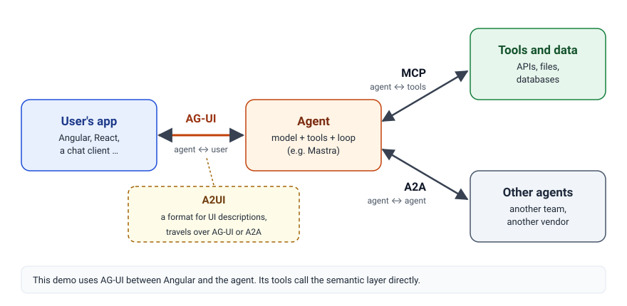
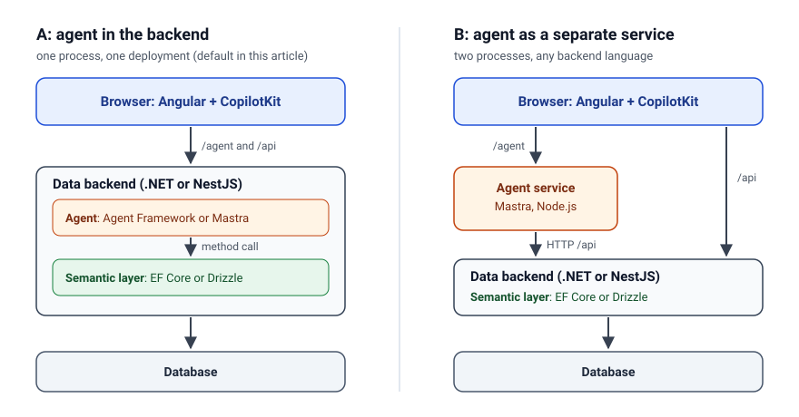
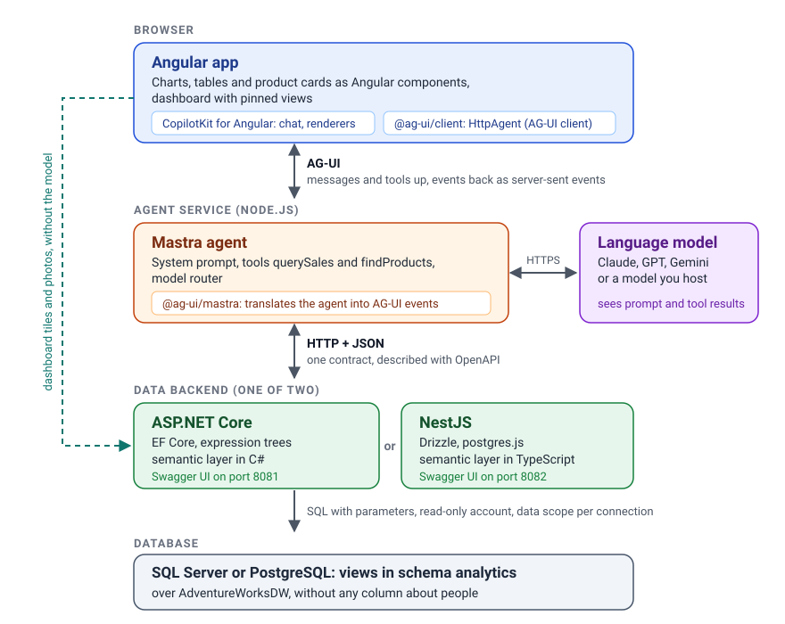
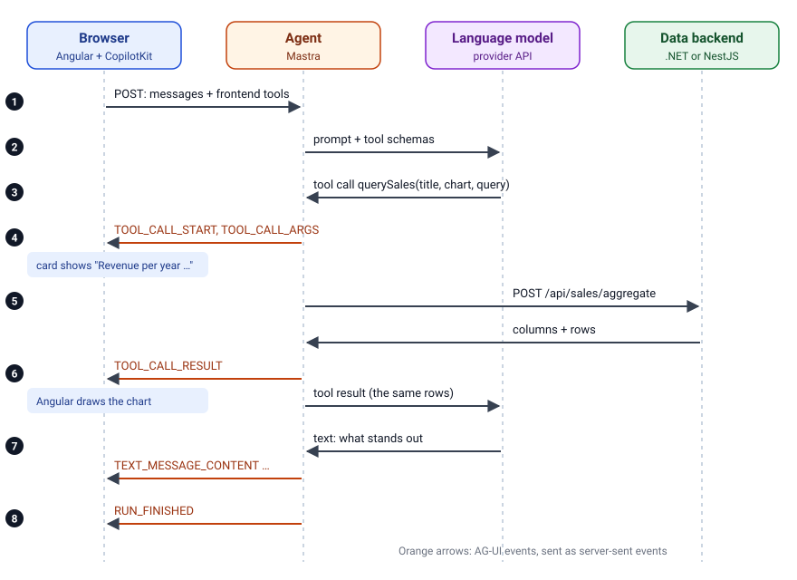
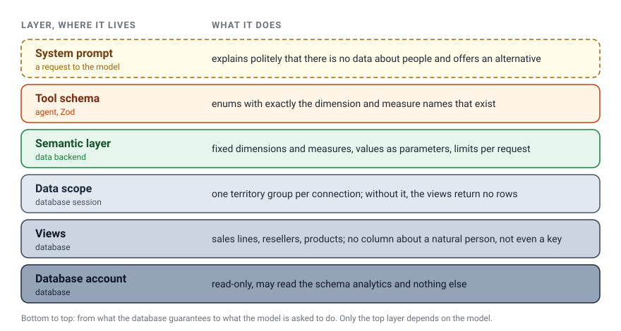

**Agentic analytics works with Angular today: you ask your sales data a question and get a chart back. And you can keep personal data away from the language model, as long as the database enforces it rather than the prompt.**

You type a question, and a chart appears.
"How did revenue develop per quarter, split by sales channel?" The app answers with a line chart, a short analysis, and a button to pin the chart to a dashboard.
No SQL, no report designer, no ticket for the BI team.

That is the promise of **agentic analytics**.
In this article, I build such an app with Angular, piece by piece, from the database up to the chat, with a backend in .NET or in Node.js, as you prefer.
If you have never built an app with an AI agent before, that is fine: the article explains every term on the way, introduces the protocols you will keep hearing about (AG-UI, A2UI, MCP, A2A), and names an alternative for every library we use.
And because this is a German blog at heart, we take a close look at the question that comes first in every real project here: **what happens to personal data?**

> The complete demo is on GitHub: [angular-schule/demo-agentic-analytics](https://github.com/angular-schule/demo-agentic-analytics).
> One `docker compose --profile node up` (or `--profile dotnet`) starts everything.

## Contents

[[toc]]

## Inspired by Manfred Steyer

The idea for this article comes from a workshop I enjoyed a lot.
On October 23, 2026, [Manfred Steyer](https://www.angulararchitects.io/) gave a free online live-coding workshop for AI Poland: *Build an Agentic Analytics App with Angular*.
In about two hours, he built a sales analytics app with Angular, [CopilotKit](https://www.copilotkit.ai/), the AG-UI protocol and the agent framework [Mastra](https://mastra.ai/).
The [recording](https://ai-poland.pl/free-workshops/recordings) and his [code](https://github.com/manfredsteyer/agentic-sales) are public, and I can only recommend both.

Two of his thoughts stuck with me.
First: the chat is only the input channel. **The result is the dashboard**, which the user and the agent build together.
Second: when the model gets something wrong, the engineers have to improve the *harness* around it: guardrails, metadata, deterministic code.

Manfred's demo works with an obfuscated Google Analytics sample dataset from BigQuery, loaded into DuckDB.
I wanted to see how the architecture holds up in a setting that looks more like our customer projects:

- a **relational database** with a classic data warehouse schema,
- **two typical backend stacks** that are interchangeable: ASP.NET Core with Entity Framework Core and SQL Server, or NestJS with Drizzle and PostgreSQL,
- and **data that contains people**, so we have to decide what the language model may see.

So this article does not repeat Manfred's code.
It retells the idea with its own demo, its own data, and a few decisions of its own.
The building blocks are the same as his: CopilotKit in Angular, AG-UI in between, Mastra on the server. For the .NET track, the Microsoft Agent Framework takes Mastra's place.

## What We Build


On the left, the user chats with an agent.
The agent answers with **Angular components**: line and bar charts, stat tiles, tables, and product cards with photos.
Every chart can be pinned to the dashboard on the right.
A pinned tile stores only the *query*, not the numbers, and asks the database again on every visit, **without the language model**.
That is fast, deterministic, and costs no tokens.

Before we build it, let's sort out the vocabulary.

## The Vocabulary in Five Minutes

If you already know what a tool call is, skip ahead to [the protocols](#the-protocols-ag-ui-a2ui-mcp-and-a2a).

**Language model (LLM).**
A large language model such as Claude, GPT or Gemini reads text and writes text.
It runs at a provider (Anthropic, OpenAI, Google) or on your own hardware, and you talk to it over an HTTP API.
On its own, it knows nothing about your database, and it cannot run code.

**Tool and tool call.**
A *tool* is a function you describe to the model: a name, a description, and a JSON schema for the parameters.
When the model decides that a tool helps, it does not answer with prose, but with a *tool call*: "call `querySales` with these arguments".
Your code runs the function and sends the result back to the model, which then continues writing.
The model never touches the database itself; it can only ask for the tools you offer.
Providers call this *function calling* or *tool use*.

**Agent.**
An agent is a language model in a loop: the model writes, calls a tool, reads the result, maybe calls the next tool, and finally answers.
In our app, the agent has a system prompt (its standing instructions), two tools, and access to a model.
Everything around the model that keeps it on track (prompt, tool schemas, validation, limits) is what Manfred calls the *harness*.

**Agent framework.**
You can write that loop yourself, but you will soon want streaming, retries, validation of tool arguments, switching providers, and logs.
An agent framework provides these building blocks.
We use **Mastra** for TypeScript and the **Microsoft Agent Framework** for C#.

**Generative UI.**
The agent's answer is more than text: it is user interface.
In our app, a question produces a chart, a table, or product cards.
CopilotKit, which also maintains the AG-UI protocol, sorts generative UI into [three kinds](https://github.com/CopilotKit/generative-ui), from "the app decides everything" to "the agent decides everything":

| Kind | Who builds the UI? | Example |
| --- | --- | --- |
| **Controlled** | The app has finished components. The agent picks one and supplies the data. | Our charts and product cards |
| **Declarative** | The agent sends a description of the UI (cards, lists, forms) from a catalogue the app knows. The app renders it with its own components. | A2UI, Open-JSON-UI |
| **Open-ended** | The agent delivers a complete piece of UI, often HTML in a sandboxed iframe. The app only provides the frame. | MCP Apps |

The further down the table, the more freedom the agent has, and the less control the app keeps over layout, design and security.
For analytics, where numbers have to be correct and charts have to look like the rest of the product, controlled generative UI is a good fit.
This demo uses only that kind.

**Server-sent events (SSE).**
A plain HTTP response that stays open and delivers one message after another.
The browser can show the first words of an answer while the model is still writing the rest.

**Semantic layer.**
A layer between the database and whoever asks the questions: a BI tool, a person, or in our case the model.
It defines the business vocabulary once.
*Measures* are numbers that can be aggregated, each with a fixed formula: revenue is the sum of the sales amount, gross margin is revenue minus product cost.
*Dimensions* are the attributes you group and filter by: year, country, product category.
A query names only these terms, for example "revenue and margin per product category in Europe", and the semantic layer translates it into SQL with the right columns, joins and aggregates.
What it does not define cannot be asked for.
It is not the ORM: EF Core or Drizzle map tables to objects for developers, while the semantic layer sits on top of them and decides which business questions may be asked at all.
The term comes from business intelligence, where Cube, dbt (MetricFlow), Looker (LookML) and Power BI (semantic models) offer one as a product.
Our demo builds a small one itself.
We will spend a whole section on it, because it decides what the model can and cannot ask for.

## The Protocols: AG-UI, A2UI, MCP and A2A

When you start reading about agents, you will meet four protocols with confusingly similar names.
They do different jobs, and an app can use several of them at once.



### AG-UI: Agent ↔ User

[AG-UI](https://docs.ag-ui.com/) (*Agent-User Interaction Protocol*) connects an agent with the app in front of the user.
CopilotKit [announced it in May 2025](https://www.copilotkit.ai/blog/introducing-ag-ui-the-protocol-where-agents-meet-users); it grew out of CopilotKit's work with LangChain and CrewAI, and it is [MIT-licensed on GitHub](https://github.com/ag-ui-protocol/ag-ui).

The idea is simple.
The app sends the agent a request with the conversation so far, the tools that the frontend offers, and optionally a shared state.
The agent answers with a stream of typed **events**:

- **Lifecycle:** `RUN_STARTED`, `RUN_FINISHED`, `RUN_ERROR`, steps in between.
- **Text:** `TEXT_MESSAGE_START`, `TEXT_MESSAGE_CONTENT` (one piece of text at a time), `TEXT_MESSAGE_END`.
- **Tool calls:** `TOOL_CALL_START`, `TOOL_CALL_ARGS` (the arguments, streamed in pieces), `TOOL_CALL_END`, `TOOL_CALL_RESULT`.
- **State:** `STATE_SNAPSHOT` and `STATE_DELTA` (a JSON Patch) for state that the agent and the app share.
- And a few more for reasoning, activities, sub-agents and custom events.

AG-UI does not prescribe a transport. Server-sent events are the common choice, and the one we use.
The protocol is supported by [many agent frameworks](https://docs.ag-ui.com/integrations), among them Mastra, LangGraph, CrewAI, Google ADK, Microsoft Agent Framework, AWS Strands Agents and Pydantic AI.
That is the main benefit for us: the Angular side does not care which framework runs on the server.

### A2UI: a Format for Generated UI

[A2UI](https://github.com/a2ui-project/a2ui) is a different kind of thing.
Google [introduced it in December 2025](https://developers.googleblog.com/introducing-a2ui-an-open-project-for-agent-driven-interfaces/) as an Apache 2.0 project; at the time of writing, it is an early public preview with v0.9 as the stable release.
A2UI is **a format, not a connection**: the agent sends a declarative JSON description of a UI ("a card with a heading, a list and a button"), and the client renders it with its own native components.
The client keeps a catalogue of trusted components, and the agent can only request components from that catalogue.
Because the description is data and not code, there is no script to inject.
There are renderers for Angular (`@a2ui/angular`), Lit and React, and Flutter uses A2UI under the hood of its GenUI SDK.

So what is the difference to AG-UI?
The AG-UI docs say it clearly: [AG-UI is not a generative UI specification](https://docs.ag-ui.com/concepts/generative-ui-specs), it is the runtime connection between agent and app.
A2UI describes *what* to show; AG-UI (or A2A) is *how* it gets there.
The two work together, and CopilotKit supported A2UI from the first day.

In our demo, the agent cannot invent new UI. It can only choose between our chart, table and product card components.
That is controlled generative UI, so we do not need A2UI.
It becomes interesting when the agent should assemble forms or layouts that nobody built in advance.

### MCP: Agent ↔ Tools

The [Model Context Protocol](https://modelcontextprotocol.io/) connects an agent with tools and data sources.
Anthropic [published it in November 2024](https://www.anthropic.com/news/model-context-protocol) and [donated it in December 2025](https://www.anthropic.com/news/donating-the-model-context-protocol-and-establishing-of-the-agentic-ai-foundation) to the Agentic AI Foundation under the Linux Foundation.
An MCP server offers tools in a standard way, so every MCP-capable agent or chat client can use them without custom code.
The extension [MCP Apps](https://blog.modelcontextprotocol.io/posts/2025-11-21-mcp-apps/) lets an MCP server also deliver interactive UI, which the host shows in a sandboxed iframe: that is the open-ended kind of generative UI.

Our two tools are tailored to this one app, and they call the semantic layer directly.
An MCP server would make sense if other agents, or a chat client such as Claude, should use the same sales tools.

### A2A: Agent ↔ Agent

[Agent2Agent (A2A)](https://a2a-protocol.org/) lets agents from different teams or vendors work together: one agent hands a task to another and gets the result back.
Google [launched it in April 2025](https://developers.googleblog.com/en/a2a-a-new-era-of-agent-interoperability/), and since June 2025 it is a [Linux Foundation project](https://www.linuxfoundation.org/press/linux-foundation-launches-the-agent2agent-protocol-project-to-enable-secure-intelligent-communication-between-ai-agents).
Our app has a single agent, so A2A plays no role here.

### At a Glance

| | Connects | Started by | Our demo |
| --- | --- | --- | --- |
| **AG-UI** | agent ↔ app (user) | CopilotKit | yes, between Angular and the agent |
| **A2UI** | a UI format, travels over AG-UI or A2A | Google | no, our components are fixed |
| **MCP** | agent ↔ tools and data | Anthropic, now Linux Foundation | no, the tools call the semantic layer directly |
| **A2A** | agent ↔ agent | Google, now Linux Foundation | no, there is one agent |

## Your First Decision: Where Does the Agent Run?

Before we look at the layers, one question shapes everything else: does the agent get its own server, or does it move into the backend you already have?



**Path A: the agent in the backend.**
The agent is a module of your existing backend.
Its tools call the semantic layer with a method call, and you deploy, monitor and secure one process, as before.
The price: the agent framework has to exist in your backend's language.
In this article, that is Mastra for NestJS and the Microsoft Agent Framework for ASP.NET Core.

**Path B: the agent as a separate service.**
The agent runs in its own process and calls the backend's HTTP API, like any other client.
Then you can pick the agent framework independently of the backend, e.g. Mastra in front of an ASP.NET Core backend.
The model's API key and the database credentials live in different processes, and the agent can be scaled or switched off on its own.
The price: a second service to host, and one more network hop for every tool call.

| | Path A: in the backend | Path B: separate service |
| --- | --- | --- |
| Processes to run | one | two |
| Agent framework | must match the backend language | free choice |
| Tool call to the data | method call | HTTP |
| API key and database credentials | in the same process | in different processes |
| Typical fit | one team, one backend | several backends or teams share one agent |

This article follows **path A**, because one process is easier to host than two.
That gives us two tracks with the same Angular app on top:

- **Node.js track:** NestJS + Drizzle + PostgreSQL, with **Mastra** as the agent.
- **.NET track:** ASP.NET Core + Entity Framework Core + SQL Server, with the **Microsoft Agent Framework** as the agent.

Both agents get the same system prompt and the same two tools, so we can also see whether the two frameworks give similar results.
Path B has [its own section](#path-b-the-agent-as-a-separate-service) further down; the demo runs it with one more Compose profile.

## The Stack from Bottom to Top

Now to the app itself. Here are all layers in one picture:



And here they are as a table, with vendor and license:

| Layer | In this demo | Vendor | License |
| --- | --- | --- | --- |
| Data | AdventureWorksDW | Microsoft | MIT |
| Database | SQL Server 2025 **or** PostgreSQL 17 | Microsoft / PostgreSQL Global Development Group | Developer edition (free for development, not for production) / PostgreSQL License |
| Data access | EF Core **or** Drizzle with postgres.js | Microsoft (.NET Foundation) / Drizzle Team / Rasmus Porsager | MIT / Apache 2.0 / Unlicense |
| Backend | ASP.NET Core **or** NestJS | Microsoft / NestJS team | MIT / MIT |
| Agent | Microsoft Agent Framework (.NET) **or** Mastra (Node.js) | Microsoft / Kepler Software, Inc. | MIT / Apache 2.0 (except the `ee/` folders) |
| Protocol | AG-UI | started by CopilotKit, open source | MIT |
| Frontend | Angular with CopilotKit for Angular | Google / CopilotKit | MIT / MIT |
| Model | Claude, GPT or Gemini | Anthropic, OpenAI, Google | commercial API |

In each of the following sections, a small table says what the layer is, who makes it, why we need it, and what you could use instead.

## Layer 1: Data and What It Must Not Contain

| Data | AdventureWorksDW |
| --- | --- |
| What it is | Microsoft's sample data warehouse of a fictitious bicycle manufacturer |
| Made by | Microsoft, in the [sql-server-samples](https://github.com/microsoft/sql-server-samples) repository, MIT license |
| Why we need it | Realistic sales data with two channels, products, regions and companies, and with people in it, so data protection is a real question |
| Alternatives | Northwind or Contoso as sample data, or your own data warehouse |

### AdventureWorks

AdventureWorks sells bicycles online to consumers and through resellers to bike shops, between December 2010 and January 2014.
The data warehouse variant **AdventureWorksDW** has exactly what an analytics demo needs: fact tables for both sales channels, plus dimensions for time, products, territories, resellers, customers and employees.
It is MIT-licensed, so we can use and redistribute it freely.

For SQL Server, the Docker image restores Microsoft's original backup.
For PostgreSQL, it imports the CSV files of the same release.
Both downloads are pinned to a commit and come with SHA-256 checksums that the image build compares, so both databases contain **identical data**.

| Database | SQL Server 2025 or PostgreSQL 17 |
| --- | --- |
| What it is | The relational database that stores the data warehouse and the views the app may read |
| Made by | Microsoft (SQL Server, the Developer edition is free for development) / the PostgreSQL Global Development Group (PostgreSQL License) |
| Why we need it | It enforces the data protection rules: views, a read-only account, a data scope per connection |
| Alternatives | MySQL, MariaDB, DuckDB for local analytics, or a cloud warehouse such as BigQuery or Snowflake |

### Company Names: Yes. People: No.

Now the interesting part.
Every reseller order in AdventureWorks has a sales representative: the **key account manager** for that bike shop.
In the warehouse, that is the column `FactResellerSales.EmployeeKey`, and behind it in `DimEmployee` are the name, email address, phone number, hourly rate, birth date and even a photo.

From the GDPR point of view, the distinction is clear:

- **The name of a company is not personal data.** A company is not a person. "Brakes and Gears bought for $877,107" is a business fact.
- **The name of a key account manager is personal data.** And as soon as we can group revenue by sales representative, we have built a performance evaluation of individual employees, and the works council will want to have a word about that.

So the rule for our app is: **the agent may analyse resellers, but never the people behind the sales.**
The same applies to online customers, who are private persons.

A prompt ("please don't talk about employees") cannot enforce this. The database can.
We create a schema `analytics` with three views.
They contain the sales lines of both channels, the resellers, and the products, and **no reference to a natural person**, not even as a key:

```sql
-- One row per order line of both sales channels.
-- Customers and sales representatives stay in the warehouse and never appear here.
CREATE VIEW analytics.Sales AS
SELECT ...                       -- channel, order date, product, territory, reseller, amounts
FROM ... AS lines
JOIN dbo.DimSalesTerritory AS t ON ...
WHERE CAST(SESSION_CONTEXT(N'TerritoryGroup') AS nvarchar(50)) IN (N'*', t.SalesTerritoryGroup);
```

The backends connect with a dedicated read-only account that may read the `analytics` schema and nothing else.
Even with a bug in the backend, there is no way to reach `DimEmployee`.

### A Data Scope That Fails Closed

The `WHERE` clause above shows a second protection.
Each backend may be restricted to one territory group, e.g. `Europe`.
The backend states its scope for every database connection: in SQL Server as a read-only session context, in PostgreSQL as a connection parameter.
**Without that value, the views return no rows.**
A forgotten configuration therefore shows nothing instead of everything.
The scope belongs to the deployment, not to a logged-in user; the demo has no login. With authentication, the backend would write the user's scope into the same session value.

Secure views protect the data. But they do not yet stop a model from writing arbitrary SQL against them.

## Layer 2: A Semantic Layer Instead of Text-to-SQL

| Backend | ASP.NET Core with EF Core, or NestJS with Drizzle |
| --- | --- |
| What it is | A small HTTP API that turns a JSON query into safe, parameterized SQL |
| Made by | Microsoft (ASP.NET Core, Entity Framework Core, MIT) / the NestJS team (MIT), the Drizzle Team (Apache 2.0) and Rasmus Porsager (postgres.js, Unlicense) |
| Why we need it | The model never writes SQL. The backend decides which measures and dimensions exist and checks every request |
| Alternatives | Any backend you know: Spring Boot, Express, Fastify, Go. For data access: Dapper, Prisma, Kysely, TypeORM. Dedicated semantic layers such as Cube or dbt's MetricFlow do the same job as a product |

The obvious idea would be to let the language model write SQL.
Please don't.
A model that writes SQL can read every column the database account can read, can write queries that run for minutes, and can be talked into almost anything by a cleverly worded question.

Instead, both backends offer a small **semantic layer**: a fixed list of *dimensions* (year, quarter, month, channel, product category, country, reseller, …) and *measures* (revenue, cost, margin, quantity, orders).
A request is plain JSON:

```json
{
  "measures": ["revenue", "margin"],
  "groupBy": ["productCategory"],
  "filters": [
    { "dimension": "territoryGroup", "operator": "eq", "values": ["Europe"] },
    { "dimension": "year", "operator": "eq", "values": [2013] }
  ]
}
```

Names outside the list are rejected with a helpful error message that names the allowed values. The model reads it and corrects its next call.
Values never become part of the SQL text; they travel as query parameters.
Fixed limits keep queries small: at most three dimensions, ten filters and 1,000 rows per request.

There is no dimension `salesRep`.
**The model cannot ask for what does not exist.**

### .NET: Expression Trees with Entity Framework Core

In ASP.NET Core, the semantic layer maps every dimension to a typed lambda expression, and every measure to an aggregate over one group of order lines:

```csharp
Time("year", "Order year", "Calendar year of the order date.", s => s.OrderYear),
Text("country", "Country", "Country of the sales territory.", s => s.SalesTerritoryCountry, listValues: true),
Text("reseller", "Reseller", "Name of the reseller company. Empty for online sales.", s => s.ResellerName, listValues: false),

new("revenue", "Revenue", "Sum of the sales amount.", "USD",
    g => Math.Round(g.Sum(s => s.SalesAmount) ?? 0m, 2)),
```

At runtime, the requested dimensions are combined into one `GroupBy` key with the `System.Linq.Expressions` API, and Entity Framework Core translates the result into parameterized SQL:

```csharp
// s => new GroupKey { I0 = s.OrderYear, S1 = s.SalesTerritoryCountry, ... }
var sale = Expression.Parameter(typeof(Sale), "s");
var bindings = dimensions.Select((dimension, index) =>
{
    var value = Rebind(dimension.Selector, sale);
    return Expression.Bind(
        DimensionSlot(dimension, index).Property,
        dimension.IsNumeric ? Expression.Convert(value, typeof(int?)) : value);
});
return Expression.Lambda<Func<Sale, GroupKey>>(
    Expression.MemberInit(Expression.New(typeof(GroupKey)), bindings), sale);
```

The measures go the same way: only the requested aggregates are bound into the result row, so a request for revenue does not count distinct orders as well.

If you know [Dynamic LINQ](https://dynamic-linq.net/), this looks familiar: both build expression trees at runtime.
The difference matters here: Dynamic LINQ *parses strings* such as `"new(OrderYear, Country)"`.
That is convenient, but it puts an expression parser into the path between the language model and the database, and versions before 1.3.0 had a [remote code execution vulnerability](https://github.com/advisories/GHSA-w65q-jcmv-28gj) (CVE-2023-32571) in exactly that parser.
Our approach only combines lambdas that were compiled together with the backend. There is nothing to parse.
The price is a little more code.

### Node.js: Drizzle

In NestJS, [Drizzle](https://orm.drizzle.team/) plays the same role.
The views are declared as existing views, and the dimensions point to Drizzle columns:

```ts
{ name: 'country', label: 'Country', description: 'Country of the sales territory.', isNumeric: false, isTime: false, listValues: true, column: sales.salesTerritoryCountry },
```

Each measure carries its SQL fragment, built with Drizzle's `sql` template tag, so columns are interpolated by Drizzle and nothing is concatenated as text:

```ts
{
  name: 'margin', label: 'Gross margin', description: 'Revenue minus product cost.', unit: 'USD',
  sql: sql<number>`round(coalesce(sum(${sales.salesAmount}), 0) - coalesce(sum(${sales.totalProductCost}), 0), 2)`.mapWith(Number),
},
```

### Two Backends, One Contract

Both backends serve the same HTTP contract: `GET /api/schema`, `POST /api/sales/aggregate`, plus a small product catalogue with photos.
Errors are [RFC 9457 problem details](https://www.rfc-editor.org/rfc/rfc9457) in both.

Each backend generates an [OpenAPI](https://www.openapis.org/) 3.1 document from its own code: ASP.NET Core from its endpoints and records, NestJS from its controllers and DTO classes.
Open a backend's port in the browser, and you land in Swagger UI: <http://localhost:8081> for .NET, <http://localhost:8082> for Node.
Start both, and the two pages show the same endpoints, the same schemas and the same types.

"The same contract" is easy to claim, so the repository contains contract tests.
One test compares the two OpenAPI documents: paths, parameters, request and response schemas with their types, required fields and enums; only descriptions and examples may differ.
The other tests send the same requests to both backends and compare the answers.
They found two differences that would otherwise have been subtle bugs:

- **Sorting of NULL values.** SQL Server puts NULLs first in ascending order, PostgreSQL puts them last. The Node backend says `nulls first` / `nulls last` explicitly.
- **Rounding.** SQL Server's `money` type has four decimal places. Both backends round amounts to cents.

With a safe and stable data API in place, the agent can use it.

## Layer 3: The Agent, with Mastra or the Microsoft Agent Framework

The agent is the part that talks to the model.
It has a system prompt, two server tools (`querySales` for the semantic layer, `findProducts` for the product catalogue), and the frontend adds a third one later.
On path A, it lives in the data backend: Mastra in NestJS, the Microsoft Agent Framework in ASP.NET Core.

| Agent (Node.js track) | Mastra |
| --- | --- |
| What it is | A TypeScript framework for agents: tools with schemas, the agent loop, a model router for many providers, plus workflows, memory, evals and observability that this demo does not need |
| Made by | Kepler Software, Inc. in San Francisco, founded by people from the Gatsby team, Y Combinator Winter 2025; version 1.0 since January 2026. Apache 2.0, except the `ee/` folders |
| Why we need it | It runs the loop between model and tools, validates the tool arguments, and speaks AG-UI through the adapter `@ag-ui/mastra` |
| Alternatives | Vercel AI SDK, LangGraph, OpenAI Agents SDK, Google ADK, AWS Strands Agents |

| Agent (.NET track) | Microsoft Agent Framework |
| --- | --- |
| What it is | Microsoft's framework for agents in .NET and Python: agents from any `IChatClient`, tools from plain C# methods, workflows, memory and hosting for ASP.NET Core |
| Made by | Microsoft, MIT license; [the direct successor of Semantic Kernel and AutoGen](https://learn.microsoft.com/en-us/agent-framework/overview/), "created by the same teams" |
| Why we need it | It runs the loop between model and tools in the ASP.NET Core process and serves AG-UI with `MapAGUIServer()` |
| Alternatives | The plain `IChatClient` of `Microsoft.Extensions.AI` with your own loop, Semantic Kernel (its predecessor), or path B with Mastra |

### Who Makes Mastra?

[Mastra](https://mastra.ai/) is made by Kepler Software, Inc., a company from San Francisco.
Its founders [built Gatsby](https://www.ycombinator.com/companies/mastra), the React web framework, before they started on Mastra in October 2024.
Mastra went through Y Combinator in Winter 2025 and [released version 1.0 in January 2026](https://mastra.ai/blog/announcing-mastra-1).
Manfred uses Mastra in his workshop, too.

For a TypeScript developer, Mastra feels familiar: tools are objects with a [Zod](https://zod.dev/) schema, agents are objects with instructions, tools and a model, and everything is plain TypeScript.
The framework is Apache 2.0, with one exception: everything in folders named `ee/` (enterprise features such as parts of the authentication) is under a separate, source-available license that does not allow production use without a contract. Our demo does not use those parts.

### Tools Generated from the Semantic Layer (Mastra)

The agent builds its tool schemas from the semantic layer, the same data that `GET /api/schema` returns.
Dimension and measure names become enums in Zod. The model sees exactly the names that exist, and Mastra rejects any other name before the tool runs:

```ts
const dimensionNames = schema.dimensions.map((d) => d.name) as [string, ...string[]];
const measureNames = schema.measures.map((m) => m.name) as [string, ...string[]];

const querySales = createTool({
  id: 'querySales',
  description: `
    Aggregates the sales data and shows the result to the user as a chart, table or key figure.
    The user sees the visualization right away, so do not repeat the numbers as a table in the answer.
    Put the measure the title is about first. ...
  `,
  inputSchema: z.object({
    title: z.string(),
    chart: z.enum(['bar', 'line', 'table', 'kpi']),
    query: z.object({
      measures: z.array(z.enum(measureNames)).min(1),
      groupBy: z.array(z.enum(dimensionNames)).max(schema.limits.maxGroupBy).optional(),
      // filters, orderBy, limit ...
    }),
  }),
  execute: ({ query }) => orError(() => data.aggregate(query)),
});
```

`data.aggregate` is the NestJS service of the semantic layer, called in the same process.
`orError()` turns every failure into a tool result instead of an exception: `{ error: 'Unknown dimension …' }` or `{ error: 'The database is not reachable.' }`.
The model can correct a rejected request or tell the user what went wrong, and the chat never hangs.

The system prompt contains the dataset description, all dimensions with their allowed values, and a few rules.
The most important one:

```text
- Personal data is not part of the data model: no sales representatives or key account managers,
  no contact persons, no customers as persons. If asked, say that this data is deliberately not
  available to you and offer an analysis at company, product or region level instead.
```

Note the order: the database guarantees that the data is not there, the prompt only makes sure the agent explains it politely.

### The Same Tools in C# (Microsoft Agent Framework)

In ASP.NET Core, a tool is a C# method.
`AIFunctionFactory` from `Microsoft.Extensions.AI` turns it into a tool: the name, the `[Description]` attributes and a JSON schema derived from the parameter types.
The query parameter is the same `AggregateRequest` record that `POST /api/sales/aggregate` accepts:

```csharp
[Description("Aggregates the sales data and shows the result to the user as a chart, table or key figure. ...")]
async Task<object> QuerySales(
    [Description("Short title for the visualization.")] string title,
    ChartKind chart,
    AggregateRequest query,
    CancellationToken ct) =>
    await OrError(() => aggregator.AggregateAsync(query, ct));

AITool[] tools =
[
    AIFunctionFactory.Create(QuerySales, Tool("querySales")),
    AIFunctionFactory.Create(FindProducts, Tool("findProducts")),
];

AIAgent analyst = new AnthropicClient { ApiKey = apiKey }
    .AsIChatClient("claude-sonnet-5-5")
    .AsAIAgent(name: "analyst", instructions: Instructions(schema), tools: tools);
```

The model comes in as an `IChatClient`, here from Anthropic's official .NET SDK; other providers bring their own.
The system prompt is the same text as for Mastra, built from the same schema.

The enums are added while the JSON schema is generated: a callback sees every property and can change its schema node, much like the OpenAPI transformer that the backend already has.

```csharp
switch (context.DeclaringType?.Name, context.PropertyInfo?.Name)
{
    case (nameof(AggregateRequest), "measures"):
        node["items"] = new JsonObject { ["type"] = "string", ["enum"] = measureNames };
        break;
    case (nameof(FilterRequest), "dimension"):
        node["enum"] = dimensionNames;
        break;
    // groupBy, operator, direction, limits ...
}
```

Two details cost me some time, and both show how much the model depends on the schema:

- **Enums need a string converter.** Without `[JsonConverter(typeof(JsonStringEnumConverter<ChartKind>))]`, the schema describes `ChartKind` as a number, and the model sends `"chart": 1` instead of `"chart": "line"`.
- **Optional is not nullable.** C# records with `string?` and `int?` become schema types like `["array", "null"]`. The model then sends `"filters": null`, and the Angular side, whose Zod schema says "optional", rejects the view. The callback therefore removes `null` from optional fields, so both agents describe exactly the same tool.

### Serving AG-UI

The browser posts the conversation, and the agent answers with AG-UI events as server-sent events.
This is what happens for one question:



In **ASP.NET Core**, the AG-UI endpoint is one line, from the package `Microsoft.Agents.AI.Hosting.AGUI.AspNetCore`:

```csharp
builder.Services.AddAGUIServer();
// ...
app.MapAGUIServer("/agent/ag-ui/analyst", analyst);
```

In **NestJS**, the package `@ag-ui/mastra` translates the Mastra agent into an AG-UI agent, and a controller streams its events:

```ts
@Controller('agent')
export class AgentController {
  @Post('ag-ui/analyst')
  async run(@Body() body: unknown, @Res() reply: FastifyReply): Promise<void> {
    const input = RunAgentInputSchema.parse(body);
    const agent = new MastraAgent({
      agentId: 'analyst',
      agent: await this.getAnalyst(),
      threadId: input.threadId,
      initialMessages: input.messages,
      streamServerToolCalls: true,
    });

    const response = reply.hijack().raw;
    response.writeHead(200, { 'content-type': 'text/event-stream' });
    await agent.runAgent(input, {
      onEvent: ({ event }) => response.write(`data: ${JSON.stringify(event)}\n\n`),
    });
    response.end();
  }
}
```

`RunAgentInputSchema` from `@ag-ui/core` checks the request body before the run starts.
Neither agent keeps a memory: CopilotKit sends the whole thread with every request.
For a demo, that is ideal: no conversation ends up in a database on the server.

### Mastra and the Agent Framework Side by Side

The Angular app does not know which framework answers; only the status line in the header shows it.
With the same model (Claude Sonnet 5.5), the same prompt and the same tools, both agents answered the example questions with the same kind of charts: a line chart for the quarterly revenue per channel, product cards for the Mountain-200, and the polite refusal for the key account manager.
Pinning a chart by chat works with both, including the confirmation after the frontend tool has run.
The texts differ from run to run, as they do with the same framework, too.

What differs is the work around it:

| | Mastra | Microsoft Agent Framework |
| --- | --- | --- |
| Language | TypeScript | C# (also Python) |
| Tool schema | written by hand in Zod | derived from C# types, adjusted in a callback |
| Validation of tool arguments | Mastra checks against the Zod schema | deserialization into the C# types; names are checked by the semantic layer |
| Models | model router with one string per provider | one `IChatClient` per provider SDK |
| AG-UI | adapter package plus a few lines of streaming | `MapAGUIServer()`, still a preview package |

On the .NET side, the AG-UI hosting package is a preview (`1.25.0-preview`) at the time of writing, while the rest of the framework is stable.
The browser console also shows compatibility warnings from the AG-UI client about fields that the .NET server sends as `null`; they do not affect the app.

### Other Agent Frameworks

Which framework fits depends mostly on your language and on whether it speaks AG-UI, because then the Angular side stays the same:

| Framework | Maker | Languages | AG-UI |
| --- | --- | --- | --- |
| [Mastra](https://mastra.ai/) | Kepler Software | TypeScript | yes, `@ag-ui/mastra` |
| [Microsoft Agent Framework](https://learn.microsoft.com/en-us/agent-framework/overview/) | Microsoft | .NET, Python | yes |
| [LangGraph](https://www.langchain.com/langgraph) | LangChain | Python, TypeScript | yes |
| [Vercel AI SDK](https://ai-sdk.dev/) | Vercel | TypeScript | yes, via `@ag-ui/vercel-ai-sdk` |
| [Google ADK](https://google.github.io/adk-docs/) | Google | Python, TypeScript, Go, Java | yes |
| [AWS Strands Agents](https://strandsagents.com/) | AWS | Python, TypeScript | yes |
| [OpenAI Agents SDK](https://openai.github.io/openai-agents-js/) | OpenAI | TypeScript, Python | in progress |
| [Pydantic AI](https://ai.pydantic.dev/) | Pydantic | Python | yes |

### Switching the Model

| Model | Claude, GPT or Gemini |
| --- | --- |
| What it is | The language model that reads the conversation and decides which tool to call |
| Made by | Anthropic, OpenAI, Google, each with a commercial API |
| Why we need it | It turns a question in plain language into a structured query and comments on the result |
| Alternatives | Any provider with an SDK for your agent framework, or an open-weight model on your own hardware via Ollama or vLLM |

Mastra has a [model router](https://mastra.ai/models): the model is a single string like `anthropic/claude-sonnet-5-5`, `openai/gpt-5.6-terra` or `google/gemini-3-flash-preview`, and the API key comes from the provider's usual environment variable.
In the Microsoft Agent Framework, you swap the `IChatClient`; the demo's .NET backend uses Anthropic only.
Either way, the setting is one line in `agent/.env`.
How well the agent works depends on the model: it has to pick the right tool, fill the query schema correctly and stick to the rules of the system prompt.
Try your questions with two or three models before you decide.

### Pitfalls: Telemetry and Peer Dependencies

- **Mastra sends usage telemetry by default** to PostHog, including token usage of the agents ([source](https://github.com/mastra-ai/mastra/blob/main/packages/core/src/telemetry/posthog.ts)). The demo switches it off with `MASTRA_TELEMETRY_DISABLED=1`. Check this in your own projects; it is easy to miss.
- `@ag-ui/mastra` declares `@copilotkit/runtime` and `@mastra/client-js` as peer dependencies, and npm installs peers automatically. The runtime brings a long list of dependencies, including analytics packages. The demo needs neither, so it installs peers explicitly instead (`legacy-peer-deps=true` in `.npmrc`). Manfred solves the same problem with an [empty stub package](https://github.com/manfredsteyer/agentic-sales/tree/main/agent/libs/copilotkit-runtime-stub).

The server side is complete. Now to the part where Angular developers feel at home.

## Layer 4: Angular with CopilotKit

| Frontend | CopilotKit for Angular |
| --- | --- |
| What it is | Chat components and APIs that connect an Angular app to an AG-UI agent and render tool calls as Angular components |
| Made by | CopilotKit (Tawkit, Inc.), a startup from Seattle founded in 2023 by Atai and Uli Barkai. MIT license. The Angular package `@copilotkit/angular` lives in the main repository and is at version 0.6, for Angular 22 |
| Why we need it | We get the chat, the streaming, and the binding between tool calls and our components, without writing an AG-UI client ourselves |
| Alternatives | Hashbrown, the Vercel AI SDK for Angular, an A2UI renderer, or your own AG-UI client. More on these below |

[CopilotKit](https://www.copilotkit.ai/) is not a Microsoft product; "Copilot" is a generic word here.
The libraries are open source under MIT. The company earns money with a commercial platform on top, which our demo does not use.
CopilotKit also started the AG-UI protocol, and its [Angular frontend](https://docs.copilotkit.ai/angular) is described as the "first-party, signal-based Angular frontend for AG-UI agents".

### Connecting the Agent

CopilotKit for Angular is configured with `provideCopilotKit()`.
We do not use CopilotKit's own runtime or cloud; the agent is an AG-UI endpoint, so an `HttpAgent` from `@ag-ui/client` is all it takes:

```ts
export const copilotKitConfig: CopilotKitConfig = {
  selfManagedAgents: {
    analyst: new HttpAgent({ url: '/agent/ag-ui/analyst' }),
  },
  renderToolCalls: [salesViewRenderer, productCardsRenderer],
  enableInspector: false,
};
```

In the template, the chat is one element:

```html
<copilot-chat [agentId]="agentId" />
```

### Three Ways to Generate UI

CopilotKit offers three ways to connect an Angular component to the agent.
Manfred summed up the difference nicely: with `registerComponent()` and `registerFrontendTool()`, **the model decides** to show something; with `registerRenderToolCall()`, **CopilotKit decides** to draw the result of a server tool.

| API | Who defines the tool? | What happens? |
| --- | --- | --- |
| `registerComponent()` | the frontend | The model calls the tool *to show* the component and passes the data as arguments. |
| `registerFrontendTool()` | the frontend | The model calls the tool, the handler runs in the browser (and may render a component). |
| `registerRenderToolCall()` | the agent | A server tool runs; the frontend only *draws* its arguments and result. |

All three are controlled generative UI in the sense of the table above: the components are ours, the agent only chooses and fills them.

Our charts use `registerRenderToolCall()`.
The tool runs on the server, and the component receives the arguments (title, chart type, query) and the result (the rows).
The model does not have to repeat the numbers as component arguments, which saves tokens and avoids transcription errors.

```ts
@Component({
  selector: 'app-sales-view-renderer',
  imports: [SalesChart],
  template: `
    @let call = toolCall();
    @if (result(); as result) {
      @if (view(); as view) {
        <app-sales-chart [title]="view.title" [kind]="view.chart" [result]="result" />
        <button type="button" [disabled]="pinned()" (click)="dashboard.pin(view)">Pin to dashboard</button>
      }
    } @else if (error(); as error) {
      <p class="error"><strong>No result.</strong> {{ error }}</p>
    } @else {
      <p class="loading">{{ call.args.title ?? 'Querying sales' }} …</p>
    }
  `,
})
export class SalesViewRenderer implements ToolRenderer<SalesView> {
  readonly toolCall = input.required<AngularToolCall<SalesView>>();
  // view(), result(), error(), pinned() are computed signals over toolCall()
}

export const salesViewRenderer: RenderToolCallConfig<SalesView> = {
  name: 'querySales',
  args: salesViewSchema,
  component: SalesViewRenderer,
};
```

`toolCall` is a signal input.
While the model is still streaming the arguments, `status` is `in-progress` and `args` is partial, so the title appears before the query is complete.
That is why every field is treated as optional until the call is complete.
When the call is complete, `result` holds the tool's answer as a JSON string: either the rows, or an error message from `orError()` or from Mastra's schema check, which the card shows instead of the chart.

Pinning works both ways: by button, and by asking the agent ("Please pin that chart to the dashboard").
For the second, the frontend registers a tool that runs in the browser.
CopilotKit sends its name and schema to the agent with every request. When the model calls it, CopilotKit runs the handler in the browser and starts a follow-up run with the handler's answer, so the model can confirm it:

```ts
registerFrontendTool({
  name: 'pinToDashboard',
  description: 'Pins a view to the dashboard next to the chat. Only when the user asks for it.',
  parameters: salesViewSchema,
  handler: async (view) => {
    // CopilotKit passes the model's arguments as parsed JSON, without checking them against the schema.
    const parsed = salesViewSchema.safeParse(view);
    if (!parsed.success) return `Not pinned, the view is invalid: ${parsed.error.message}`;
    return dashboard.pin(parsed.data)
      ? `Pinned "${parsed.data.title}" to the dashboard.`
      : 'This view is already on the dashboard.';
  },
});
```

The handler validates again, and that is a trap worth knowing: the Zod schema describes the tool for the model, but CopilotKit does not validate the arguments.
Without the check, a single malformed pin is stored as is, and on the next page load the dashboard's validation discards *all* tiles.
**Treat everything the model sends as untrusted input**, just like a form submitted from the internet.

### Charts: Telling the Truth

The charts are plain Angular components (bars in HTML and CSS, lines in SVG) with tooltips, a legend for several series, a colour palette that works for colour-blind readers, and a switch to a table view.
No chart library is needed for that.

A typical trap in generative UI: ask for "the gross margin of the product categories in Europe in 2013", and the model requests revenue *and* margin and titles the chart "Gross margin by product category".
A chart that simply plots the first measure then shows revenue under a margin title, while the text answer below is correct.

Two things prevent that here: the tool description tells the model that the first measure is plotted, and the chart does not guess.
Measures with the same unit are drawn side by side, and the chart always says what it shows ("Revenue (USD)", "Values (USD)"), taken from the query and not from the title.

### Dashboard: Running Without the Model

A pinned tile is a `SalesView`: title, chart type, query.
It is stored in `localStorage` and loaded with `httpResource()` directly from the data backend:

```ts
protected readonly data = httpResource<AggregateResponse>(() => ({
  url: '/api/sales/aggregate',
  method: 'POST',
  body: this.tile().query,
}));
```

Manfred calls this the difference between *design mode* and *runtime mode*: the agent helps to design the view once, and from then on it runs like any other report.

### Alternatives to CopilotKit

CopilotKit is not the only way to bring an agent into an Angular app.
These are the options I would look at:

| Library | Maker, license | Frameworks | How it works |
| --- | --- | --- | --- |
| [CopilotKit](https://docs.copilotkit.ai/angular) | CopilotKit, MIT | Angular, React, Vue | Chat and tool rendering for an agent on the server, over AG-UI |
| [Hashbrown](https://hashbrown.dev/) | LiveLoveApp, MIT | Angular, React | Headless: the model renders your registered components and calls tools that run in the browser. A thin server adapter keeps the API key and streams AG-UI events |
| [Vercel AI SDK UI](https://ai-sdk.dev/docs/getting-started/angular) | Vercel, Apache 2.0 | React, Vue, Svelte, Angular (`@ai-sdk/angular`) | Chat state and streaming for a backend built with the AI SDK; no ready-made chat components for Angular |
| [A2UI renderer](https://github.com/a2ui-project/a2ui) | started by Google, Apache 2.0 | Angular, Lit, React, Flutter | Renders declarative UI descriptions from the agent with your component catalogue; needs a transport such as AG-UI |
| [assistant-ui](https://www.assistant-ui.com/) | AgentbaseAI, MIT | React | Chat components for React with an AG-UI adapter; for Angular teams only relevant in a React micro-frontend |
| Your own AG-UI client | you | any | `@ag-ui/client` plus a few signals; you write the chat UI yourself |

The main difference is where the agent lives.
Hashbrown runs the agent loop in the browser: tools have direct access to your services and state, and the server only holds the API key.
CopilotKit connects the Angular app to an agent on the server.
That is the right choice when tools need database access that must never reach the browser, as in our demo.

The Angular team itself does not offer a chat or generative UI library; [angular.dev/ai](https://angular.dev/ai) points to Genkit, Firebase AI Logic and the Gemini API for AI features.

## Path B: The Agent as a Separate Service

Path B moves the agent out of the backend into its own Node.js service.
The demo contains it in the folder `agent/`: the same Mastra agent, the same prompt, the same tools.
Only two things change.

First, the tools call the backend's HTTP API instead of a service in the same process, and the agent loads the semantic layer at startup from `GET /api/schema`.
That works with both backends, because they share one contract:

```ts
const schema = await dataApi.schema();   // GET /api/schema, retried until the backend is up

execute: ({ query }) => orError(() => dataApi.aggregate(query)),   // POST /api/sales/aggregate
```

Second, the service needs its own small HTTP server for AG-UI. A plain `node:http` server with the same `MastraAgent` code as in the NestJS controller is enough.

The browser then talks to two servers: `/agent` goes to the agent service, `/api` (dashboard tiles, photos) still goes directly to the backend.
In the demo, one more Compose profile and one variable switch to path B:

```bash
AGENT_URL=http://agent:4111 docker compose --profile dotnet --profile agent up
```

Manfred's workshop uses this path, too: his agent runs on Mastra's own server next to an aggregation server.
For a workshop with interchangeable backends, path B is handy. In a customer project with one backend, I would start with path A.

## Test: Who Is the Key Account Manager?

Time for the question the whole data layer was built for.
The chat offers a few example questions above the input field. One of them is "Who is the key account manager of our biggest reseller?", and the agent answered:

> I can't tell you that. Data on people, such as key account managers and sales representatives, is deliberately not available to me. I can show you the biggest reseller as a company, though.

Then it called `querySales`, showed the top 10 resellers as a bar chart, and named the biggest one: Brakes and Gears, with $877K from 12 orders.
That is exactly the line we drew: **company names yes, people no.**
And if the model had tried anyway, there would have been nothing to find.

## What Goes to the Model Provider?

Here are all the protections in one picture, from the database at the bottom to the prompt at the top:



The protection has limits, and you should know them.

- **Everything a tool returns goes to the language model.** The aggregated rows, the product names, the reseller names. The semantic layer and the views decide what that is. That is why personal data must be kept out *before* the model instead of being filtered *after* it.
- **Product photos do not.** The product cards load the images directly from the data backend; the model only sees product keys and names.
- **The dashboard does not.** Pinned tiles never touch the model.
- **The browser talks to one origin only.** The app loads no fonts, scripts or telemetry from third parties, and the CopilotKit Inspector (which [reports usage](https://github.com/CopilotKit/CopilotKit/blob/main/packages/web-inspector/src/lib/telemetry.ts) when opened) is disabled.
- **Removing a column does not prevent every inference.** In AdventureWorks, only two to six sales representatives sold in each region, and in Germany only two. Anyone who knows who looks after the German bike shops gets very close to their figures with "revenue per country", although the system knows nothing about them. In a real project, agree on the granularity with your data protection officer and the works council: suppress small groups, use coarser regions, or leave a dimension out entirely. Technically, that is the same principle as the views: what is not in the semantic layer cannot be asked for. Only this time it applies to the dimensions instead of the columns.

For real customer data, you also need a data processing agreement with the model provider, ideally with EU data residency, or a model you host yourself.
In both agent frameworks, switching the provider is a small change.

One more number for your planning: CopilotKit is not small.
It brings Markdown rendering, syntax highlighting, KaTeX and web components, and the initial bundle of the demo is about 1.5 MB compressed.
In my opinion, that is fine for an internal analytics tool, but not for a public landing page.

## What This Demo Leaves Out

Manfred's workshop goes further in a few directions that I deliberately skipped:

- **Shared agent state** (AG-UI's `STATE_SNAPSHOT` and `STATE_DELTA`), where the agent itself edits the dashboard, e.g. "change every tile to a bar chart".
- **A2UI**, so the agent can assemble UI from a catalogue of components at runtime.
- **JSONata** as a sandbox in which the model can compute derived figures.
- **Human-in-the-loop** approvals for large queries.

If you want to see these, watch his recording and read his code. In my opinion, that is the natural next step after this article.

## Conclusion

Agentic analytics with Angular works today, and it works with the stacks we already use.
The technology choice looks confusing at first, but each piece has one job: the model decides, Mastra or the Microsoft Agent Framework runs the loop and the tools, AG-UI carries the events, CopilotKit draws them as Angular components, and the backend and the database decide what data exists at all.
Every piece can be replaced on its own.

Six architectural decisions make the app work:

1. **Put the agent where your team already works.** In the existing backend (path A), with the agent framework of its language, or as a separate service (path B) when several backends share it.
2. **Keep personal data out of the views**, enforced by the database, not by the prompt.
3. **Give the model a semantic layer instead of SQL.** Typed in C# or TypeScript, validated on the server.
4. **Let the agent call tools, and let Angular draw them.** CopilotKit and AG-UI do the plumbing.
5. **Treat model output as untrusted input**, and let components decide what is true.
6. **Pin the result** and run it without the model from then on.

The complete code with both backends and both paths is on GitHub: **[angular-schule/demo-agentic-analytics](https://github.com/angular-schule/demo-agentic-analytics)**.
Clone it, run `docker compose --profile node up` or `docker compose --profile dotnet up`, and ask your own questions.
Many thanks to Manfred Steyer for the inspiring workshop!

How do you keep personal data away from your agents? I'm curious about your approaches, so let me know.
